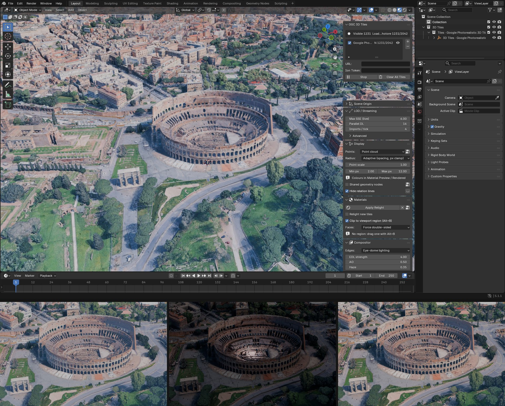
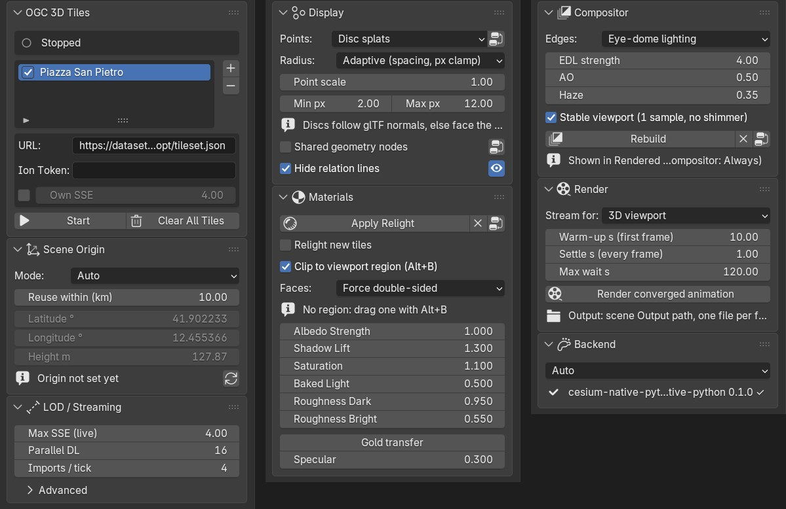
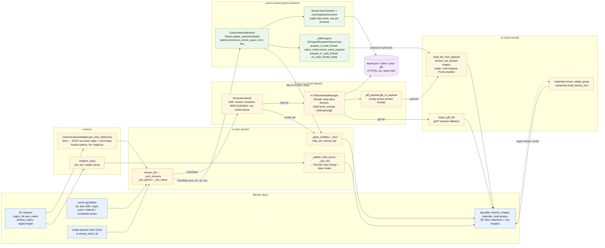
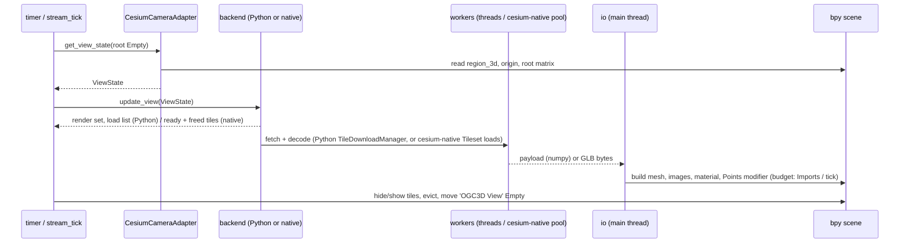
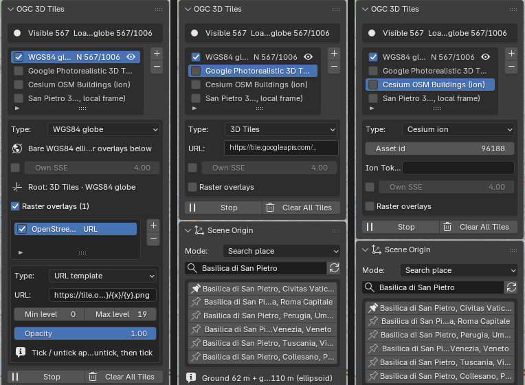
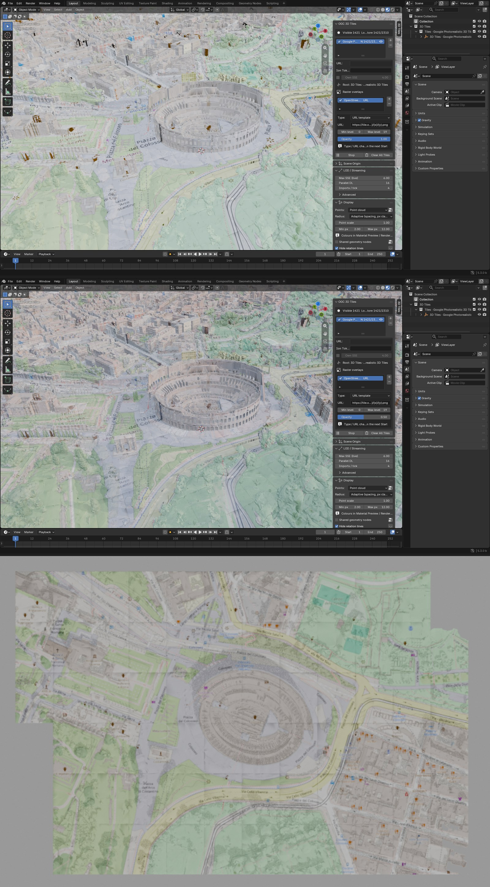
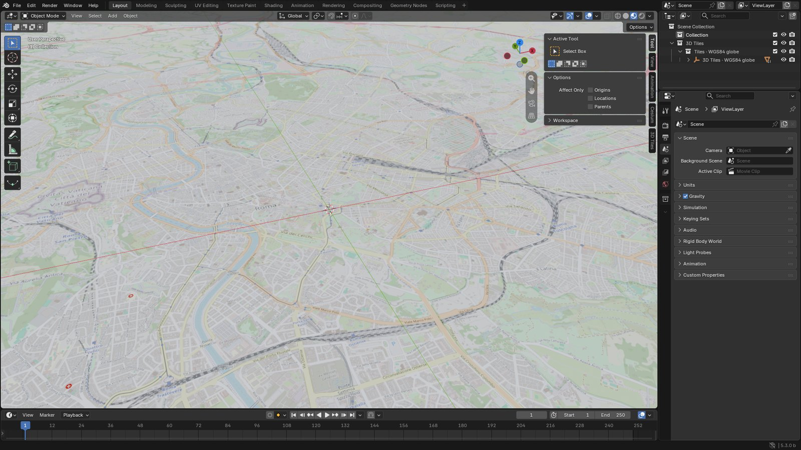
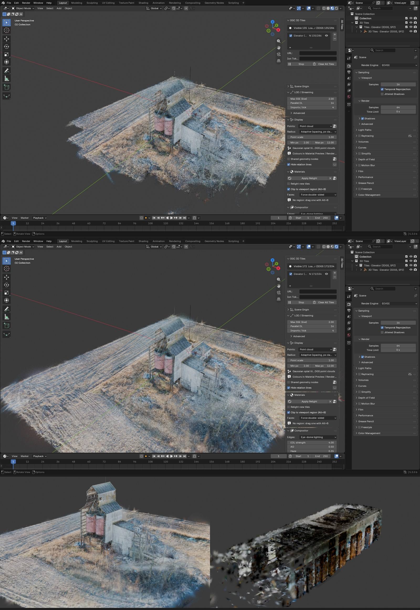

# OGC 3D Tiles Streaming — Blender Plugin






Stream OGC 3D Tiles tilesets directly into Blender with Cesium-compatible
Level-of-Detail and non-blocking HTTP downloads. Two interchangeable
backends: pure Python (always available) or cesium-native via
[cesium-native-python](https://github.com/calebbuffa/cesium-native-python).

## Installing the native backend

The cesium-native backend is an optional wheel, `cesium-python`, built from
[cesium-native-python](https://github.com/calebbuffa/cesium-native-python).
No compiler is needed: Preferences, Add-ons, OGC 3D Tiles, **Install wheel
from GitHub Release** (also offered in the sidebar's Backend section while
the binding is missing) downloads the wheel matching Blender's CPython and
platform from the latest Release of the configured repository and
pip-installs it into Blender's Python.  The default repository is the
[jo-chemla fork](https://github.com/jo-chemla/cesium-native-python/releases)
whose CI builds Linux x86_64, Windows x64 and macOS arm64 wheels for CPython
3.11 to 3.13; switch it to the upstream repository (or to PyPI, with `pip
install cesium-python` in Blender's Python) once wheels are published there.
"Build / install from source" remains for a local checkout.

## Architecture

```
blender_ogc3dtiles/
├── __init__.py              # bl_info, register/unregister
├── addon_prefs.py           # backend choice (AUTO / CESIUM / PYTHON), dev options
├── tileset/
│   ├── traversal.py         # Tile tree, transforms, SSE, culling, select()  (no bpy)
│   ├── backend.py           # PythonBackend + factory / probe
│   ├── native_backend.py    # cesium-native backend (real binding API)      (no bpy)
│   └── props.py             # bpy.types.Scene.ogc3dtiles PropertyGroup
├── camera/__init__.py       # viewport → ViewState (ECEF pos/dir/up, p00/p11, frustum)
├── io/__init__.py           # thread pool fetch + unwrap + disk cache, GLB import
└── ui/__init__.py           # sidebar panel + modal operator (stream_tick)
```

### Pipeline at a glance

Both backends share the same contract: every streaming tick, the add-on
reads the viewport from `bpy`, hands a `ViewState` to a *backend* that
decides which tiles to draw and which to load, and turns the content that
arrives into Blender objects.  Only the middle differs.



What each stage needs and produces:

| stage | reads | produces | thread |
|---|---|---|---|
| `camera.CesiumCameraAdapter` | viewport matrices, scene origin (lat/lon/h), root Empty transform | `ViewState` in the tileset's ECEF frame | main |
| `traversal.select` (Python) | `Tile` tree (parsed `tileset.json`, external tilesets grafted on arrival), `ViewState`, Max SSE, foveation | render set, keep set, one priority-sorted load list | main |
| `io.TileDownloadManager` | load list, token, disk cache | `FetchResult`: GLB parts (+ RTC) or external tileset JSON, numpy payloads when *Direct mesh* | worker threads |
| `CesiumNativeBackend.update_view` | `ViewState` as position / direction / up / fov | tiles to render, newly ready / freed tiles, stats | main (cesium-native pool for loads) |
| `_GlbPreparer.prepare_in_load_thread` | `Model` from cesium-native | numpy payload (`native_mesh.extract_mesh_payload`) or stripped GLB bytes | cesium-native workers |
| `io.build_tile_from_payload` / `import_glb_file` | payload or GLB file, tile matrix (`tile_world_matrix`, `apply_payload_offset` in float64) | mesh object under the root Empty, hidden until selected | main |
| `_apply_visibility` / `_evict` | render set, keep set, Max Tiles | `hide_set`, `remove_tile` | main |
| `materials` / `compositor` | tile objects, panel sliders | shared "OGC3D Relight" group, "OGC3D Beauty" compositor tree | main, on demand |

One tick, in order:



### Several tilesets at once

The sidebar holds a list of tilesets (add / remove, per-entry type, source
and SSE).  An entry is one of three types: **3D Tiles** (a `tileset.json`
URL or local path), **Cesium ion** (asset id and access token; the token is
only sent to Cesium ion) or **WGS84 globe** (cesium-native's procedural
ellipsoid, a bare globe to drape imagery on).  Each entry has a *Raster
overlays* checkbox, off for 3D Tiles and ion entries and switched on when
the type becomes globe; the overlay list only shows when it is ticked, and
ticking it while streaming adds or removes the overlays live.  Ion and globe
entries need the cesium-native backend.



Every entry becomes its own stream with its own backend instance,
download manager, root Empty (`3D Tiles · <name>`) and sub-collection
(`Tiles · <name>`), all sharing the scene origin and the viewport camera.
Moving, rotating or scaling a root Empty is honoured by culling and SSE for
that tileset only.

Per row: the checkbox **pauses** the stream (nothing is loaded or evicted,
loaded tiles stay as they are), the eye hides its sub-collection (same as the
outliner).  Entries added, ticked or removed while streaming are picked up on
the next tick.  **Max SSE** (LOD / Streaming sub-panel) is the live renderer setting for
every stream; tick *Own SSE* on an entry to override it for that tileset.
Both re-select immediately on both backends.  *Start* discards the tiles a
previous *Stop* left on screen (they belong to a dead selection).  Two
entries with the same label get separate collections (`… - 2`; the list
entry is renamed to match).  Editing the URL of a running entry restarts
that stream with the new URL.  **+** adds an empty entry (or one prefilled
from the URL field when that URL is not in the list yet); share links
(`/s/<token>/<asset>.json`) are labelled by the asset, never by the token.

Load order (Python backend): the tree is walked with a stack (depth-first)
but every requested tile goes into one queue that is sorted before download,
so the walk order does not matter.  The sort key is depth first (all missing
ancestors before any deeper tile), then CesiumJS-style foveated: shallow tiles first,
then by screen-space error weighted towards the view centre (*Foveation
cone* = fraction of the view half-angle); *Edge SSE relax* > 0 additionally
lets the periphery stay coarser.  cesium-native orders its own queue the same
way internally.  "Hide relation lines" (Display sub-panel) switches off the
dashed object→parent overlay in every 3D viewport on Start — it is a
per-viewport overlay, Blender has no per-object switch.

### Scene origin

All streams share one ENU origin (`Scene Origin` sub-panel):

- **Auto** — centre on the first tileset.  On a later Start the current origin
  is kept when the new tileset's centre lies within *Reuse within* km of it
  (default 10 km, CloudCompare-style), otherwise the scene is re-centred.
- **Keep current** — never move it once set.
- **Custom** — use the typed latitude / longitude / height.

The origin is stored in the .blend; *Reset Origin* forgets it.

### Streaming loop (both backends)

Every 50 ms the modal operator runs `ui.stream_tick()`:

1. drain worker results (external `tileset.json` are grafted into the tree,
   ready GLBs are queued),
2. import at most `Imports / tick` GLBs with `bpy.ops.import_scene.gltf`
   (the only main-thread cost; 1 keeps the viewport smooth),
3. re-run the selection only when the view changed, something arrived, or
   0.5 s passed,
4. submit loads in priority order (largest screen-space error first) up to
   the download concurrency,
5. evict least-recently-wanted hidden tiles above `Max Tiles`.

Imports never touch the user's selection or active object. Every tile is
parented to one root Empty per tileset inside the `3D Tiles` collection, so
the whole dataset can be moved / rotated / scaled, hidden or folded as one.

### Pure Python backend (`tileset/traversal.py`)

- Tile `transform` matrices compose down the tree; `box`/`sphere` volumes
  are transformed, `region` is geodetic.
- Screen-space error `sse = ge · viewport_h · p11 / (2 · dist)` with `p11`
  read from the viewport projection matrix (exact FOV, orthographic aware).
- Frustum culling with the viewport's own planes (rotated into ECEF) plus a
  maximum distance (`Max Distance`).
- Dynamic SSE: `thr(d) = SSE · (1 + d / Detail Falloff)`, so detail
  concentrates near the camera and distant regions settle at coarse LODs.
- `REPLACE` keeps the parent visible until every visible child subtree is
  imported (no holes); `ADD` renders parent and children together.
- Workers unwrap `b3dm` / `cmpt` / `glb`, trim the 8-byte container padding
  some exporters (RealityCapture) add, extract `RTC_CENTER` / `CESIUM_RTC`,
  and write GLBs into `%LOCALAPPDATA%/blender_ogc3dtiles/cache`; a second
  session of the same tileset downloads nothing.
- Placement: tile Empty = `ENU_from_ECEF · T_tile · Translate(RTC)`; Blender's
  importer already converts glTF Y-up to Z-up.

### Orthographic viewports and the clip range

The Python traversal reads the orthographic projection directly (SSE =
`ge · viewport_h / frame_height`, no distance term).  cesium-native only
knows perspective cameras, so for an orthographic viewport the adapter hands
it a 1-degree camera pulled back far enough that its frame at the view pivot
matches the orthographic frame: same screen-space error, same tiles, instead
of the thin cone / inflated SSE an un-adjusted 1-degree camera gives
(`ViewState.native_position`, `ortho_eye_offset`).  cesium-native fog
culling is off (it is height-based and would cull that far eye's view).

When a tileset root arrives the add-on sizes every 3D viewport's clip range
to it: clip end = 6 x the root radius, clamped to 1 km - 200 km, clip start
raised to clip end / 1e6; camera objects get the same clip end when theirs
is smaller (the 100 m default renders a site-scale tileset as empty).  The fixed 1e6 m clip end of earlier versions had
two side effects: Blender's clipping region (Alt+B) computes its planes in
single precision from the near and far corners, and past a far / near ratio
of about 1e7 the planes come out NaN (nothing is clipped, or a flat slab is);
and orthographic depth, which spans the whole clip range linearly, dropped to
centimetre precision.  Raise the clip end by hand for globe-scale tilesets;
keep clip start above clip end / 1e7 if you use Alt+B.  The clipping region
only affects drawing, not which tiles stream, and in Blender 5.1 only Solid
and Wireframe shading honour it: EEVEE (Material Preview, Rendered) ignores
the clipping region on any scene, add-on or not.  **Clip to viewport region**
(Materials section) works around that: every tile material gets a Mix Shader
to a Transparent BSDF driven by the shared 'OGC3D Clip' group, into which the
add-on copies the viewport's clip planes each tick.  While it is on, Alt+B
alone toggles the clipping (drag a region to clip, Alt+B again to clear);
the planes come from the largest 3D viewport, and F12 renders use whatever
region that viewport last had.  It is on by default; untick to remove the
nodes again.  **Faces** below it sets back-face handling for every tile
material (EEVEE and Cycles): *Force double-sided* (default: clipped or open
meshes show their inside), *Force single-sided*, or *Material setting*,
which restores what the tile declared (glTF `doubleSided`; most
photogrammetry exports are single-sided, which is why tiles used to vanish
from behind).

### Raster overlays



With the cesium-native backend any streamed tileset can be draped with
raster imagery, the way Cesium for Unreal / Unity do it: add entries under
*Raster overlays* in the tileset box (URL template `{z}/{x}/{y}`, TMS, WMTS,
WMS, Cesium ion imagery, Bing Maps, Google Map Tiles 2D, or cesium-native's
debug colouriser) and press Start.  cesium-native projects each tile onto
the overlay's tiling scheme, adds a `_CESIUMOVERLAY_<n>` texture-coordinate
set to the tile and streams the raster tiles that cover it at a resolution
matching the tile's screen size; the add-on turns each raster into a packed
Blender image and inserts, per tile material, a *UV Map → Mapping → Image
Texture → Mix* chain over the material's colour (also under the Relight
group).  *Opacity* is live.  Ticking / unticking an overlay while streaming
is live too: cesium-native reloads the loaded tiles with the new texture
coordinates (to apply an edited URL, untick then tick).
Several overlays stack in list order.  Overlays only make sense on surface
tiles (meshes); point clouds and Gaussian splat tiles have no texture
coordinates.  The raster images are packed into the .blend, so a saved scene
keeps its drape.



**WGS84 globe.** A tileset entry of type *WGS84 globe* streams
cesium-native's procedural ellipsoid instead of a tileset.json: a bare
globe, subdivided as the camera approaches, to drape imagery on when there
is no 3D Tiles content (the scene origin is yours to set: use *Custom*).
Terrain: cesium-native streams quantized-mesh terrain (Cesium World Terrain
on ion, or any `layer.json` server) as a tileset, so real terrain can be
draped the same way; Terrarium / Terrain-RGB raster DEMs are not terrain
providers in cesium-native and are out of scope here.

See [docs/cesium-native-versions.md](docs/cesium-native-versions.md) for
what newer cesium-native releases would add (vector overlays, orthographic
view states) once the Python binding bumps its submodule.
### Gaussian splat tiles



Tiles whose glTF carries `KHR_gaussian_splatting` (SPZ-compressed through
`KHR_gaussian_splatting_compression_spz_2`, as 3dtiled, the Cesium tilers
and the 3DGS-PLY-3DTiles converter write them) stream through the
cesium-native backend like any other content: cesium-native decodes the
SPZ payload and the direct-mesh path carries position, colour and opacity,
rotation, scale and the spherical-harmonic coefficients into the tile.  On
Blender 5.3 or newer the tile gets the shared 'OGC3D Splats' Geometry Nodes
group (Mesh to Points, Set Point Cloud Type: 3D Gaussian Splat) and is a
native Gaussian splat point cloud, rendered by Workbench, EEVEE and Cycles
with Blender's splat pipeline.  The attribute conventions follow Blender's
SPZ importer: `radiance:base` holds the spherical-harmonic DC term plus
opacity, `scale` is in metres, `rotation` a (w, x, y, z) quaternion,
`radiance:sh_n` the higher-degree coefficients; the glTF Y-up to Z-up change
conjugates the rotation and permutes the scale axes.  Below Blender 5.3 the
same tiles show as coloured points with the usual point display modes.
LOD, scene origin, clipping, the render pipeline and the converged
animation render apply unchanged.  Blender sorts splats per object, so
where a parent and its children overlap during a REPLACE transition the
blend order between tile objects is undefined for a moment.

A tileset that is not georeferenced (its root sits at the ECEF origin, as
3dtiled and other local converters write it) is detected at start and gets an
identity frame: the tileset's own Z-up axes and metres become the Blender
scene, centred vertically.  The Scene Origin panel then reads "Local tileset".

Tested with 3dtiled output and with the public sample of the
[3D-Tiles-RendererJS 3DGS plugin](https://github.com/WilliamLiu-1997/3D-Tiles-RendererJS-3DGS-Plugin)
(`data/Elevator-3dtiles/tileset.json` on raw.githubusercontent.com, degree-3
spherical harmonics).

### Editing tile geometry

**Shared geometry nodes** (Display section) puts one Geometry Nodes
modifier, 'OGC3D Tile Geometry', first in the modifier stack of every tile
mesh, loaded or streamed later, so a single graph edits the vertices, edges
or attributes of all tiles (the point display modifier runs after it).  The
group starts as a pass-through; the node-tree button opens it pinned in a
node editor.  Untick to remove the modifier from every tile; the group stays
in the file for the next time.

### Rendering animations with converged tiles

Blender cannot pause inside a render to wait for tiles: streaming advances
on the UI timer, which stops while a frame renders, so *Render Animation*
renders whatever happens to be loaded.  The **Render** section does it the
other way round:

- **Stream for**: *3D viewport* (interactive, default) or *Scene camera*,
  which selects tiles for the active camera at the render resolution, so
  scrubbing the timeline re-selects tiles along the camera path.
- **Render converged animation** steps through the frame range from the
  scene camera.  The first frame waits at least *Warm-up s* (default 10:
  empty scene, cold cache).  Every frame then waits until the download /
  build queue is empty and nothing has changed for *Settle s* (or until
  *Max wait s* has passed), renders the frame with the scene's output settings to the
  Output path (one file per frame, like Render Animation), then moves on.
  ESC cancels; the sidebar shows the frame, the queue length and how long
  the scene has been quiet.  Streaming starts if it is not running, and the
  stream mode is restored afterwards.

Rule of thumb for *Settle s*: the time the viewport usually takes to stop
changing after you jump the camera, plus a margin; one or two seconds on a
local cache, more over a slow link.  Lower *Max SSE* before rendering if
you want finer tiles than you use interactively.

### Cycles viewport

Cycles restarts its viewport render whenever the scene is tagged for update.
The add-on therefore keeps the per-tick status line out of scene properties
and only redraws the sidebar; tiles appearing or disappearing still restart
it, which is unavoidable.  If "GPU Compute" is greyed out in the render
device selector, no device is ticked under Preferences, System, Cycles
Render Devices (CUDA / OptiX / HIP / oneAPI / Metal).

### Direct mesh construction (cesium-native, default)

`tileset/native_mesh.py` turns the decoded cesium-native `Model` into numpy
arrays on the worker thread (positions with node transforms applied and
converted to Z-up, triangle indices, per-loop UVs, normals, COLOR_0, the
original JPEG/PNG bytes of the textures or PNG re-encoded from decoded
pixels for KTX2).  `io.build_tile_from_payload` then creates the mesh with
`foreach_set`, packs the textures from bytes and builds a matte Principled
material.  Point clouds (`pnts`, glTF POINTS) become vertex-only meshes with
a `Col` colour attribute (COLOR_0 decoded straight from the buffer, ubyte /
ushort / float) and a shared Geometry Nodes modifier.  Four radius modes:
**Adaptive** (default): 0.6 × the tile's mean point spacing (5th–95th
percentile extent / point count, ignored below 64 points) × *Point scale*,
clamped to a *Min / Max pixels* range measured at the **view pivot
distance** (eye → orbit centre in the viewport, camera → point tiles when
rendering).  One distance for the whole scene means every tile of one LOD
level gets the same radius, and the two metre bounds are plain Value nodes
rewritten only when the distance moves by more than 15 %, so the point
tiles re-evaluate while zooming, never while orbiting (Potree's adaptive
size); **Per tile** is the same without the pixel clamp; **Uniform** is one
radius for every tile; **Screen pixels** is the exact per-point version,
radius = pixels × distance to the eye, clamped to a metre range (constant
on-screen size like 3DTilesRendererJS' point size with attenuation) — this
one reads the eye from the 'OGC3D View' Empty, so every point tile
re-evaluates whenever the eye moves.  The streaming tick (or, when nothing
streams, a 0.15 s timer) feeds the viewport, a `render_pre` handler the
scene camera.  Three display modes
(`Display` sub-panel): **Point cloud** (Mesh → Points; cheapest; unlit
vertex colours in Material Preview / Rendered, material colour in Solid),
**Tiny tetrahedra** (4 vertices per point, realised as a mesh whose active
colour attribute is `Col`, so Solid mode with Color → Attribute shows the
colours as well) and **Disc splats** (an 8-gon disc instanced on every
point, not realised; oriented along the point's glTF normal when the tile
has one — kept as the `ogc3d_normal` attribute — otherwise facing the view
through a shared "View Dir" vector refreshed per tick / render; the point
material reads `Col` through both a Geometry and an Instancer Attribute
node, since instance attributes only reach EEVEE through the latter).
Measured main-thread cost per tile: 8–9 ms direct vs 10–13 ms
through `bpy.ops.import_scene.gltf`; the direct path also needs no temp files
and works regardless of which glTF extensions Blender's importer knows.
Toggle: "Direct mesh" in the sidebar (off = GLB re-import).

The Python backend uses the same route: `tileset/gltf_payload.py` is a pure
numpy GLB reader (any accessor type incl. KHR_mesh_quantization, interleaved
views, strips/fans/points, embedded JPEG/PNG) that runs on the download
workers (~2 ms per tile) and feeds `build_tile_from_payload`; Draco, meshopt,
KTX2 or external buffers fall back to Blender's importer.  Both producers
recentre the vertices on their float64 centroid and move the offset into the
object matrix, so content with projected-CRS or ECEF magnitudes in its node
transforms never gets quantised to float32 (0.1 m steps, view-dependent
wobble).  HTTP uses one keep-alive `requests.Session` per worker thread (TLS
handshake once per thread, not once per tile).

### cesium-native backend (`tileset/native_backend.py`)

Needs the `cesium` module (built from cesium-native-python, Python ≥ 3.12,
same minor version as Blender's interpreter). It constructs
`Tileset(TilesetExternals(CachingAssetAccessor(CurlAssetAccessor), preparer, AsyncSystem), url)`
and drives it with `update_view_group`. cesium-native does the traversal,
implicit tiling, `b3dm/i3dm/pnts/cmpt` conversion, Draco / meshopt / KTX2
decoding, the LRU tile cache (`maximum_cached_bytes`) and the sqlite HTTP
cache. Our `IPrepareRendererResources` subclass serialises each decoded
`Model` back to a GLB (`GltfUtilities.collapse_to_single_buffer` +
`GltfWriter.write_glb`, KTX2 textures re-encoded to PNG) which the same
import step consumes. Placement: Empty = `ENU_from_ECEF · T_tile · Zup→Yup`.

---

### Compositor

The "Compositor" sub-panel builds the 'OGC3D Beauty' tree on the current
scene (`compositor.py`: edges, AO, ASC-CDL grade, depth haze, glare) and
switches every 3D viewport's compositor to *Always*, so Rendered shading
shows it live; the Compositing workspace shows the nodes.  The tree holds
both edge branches; *Edges* (eye-dome lighting from depth, Sobel creases
from normals, or both), *EDL strength*, *Crease strength*, *AO* and *Haze*
drive Value nodes of the existing tree, so they update live without a
rebuild (*Rebuild* only re-derives the haze range from the loaded extent).
Viewport quirks handled: the viewport compositor's Depth pass is 0 / NaN
where nothing is drawn (sanitised to "far"), its Mist and AO passes are 1
everywhere (haze is a ramp on Depth instead), and Rendered shading lights
the scene with the world only — *Build* brightens Blender's default
dark-grey world once when the scene has no sun lamp, otherwise the tiles
look black next to Material Preview's studio HDRI.  *Stable viewport*
(default on) renders the viewport with one TAA sample while the tree is
built: EEVEE jitters every accumulated sample by a sub-pixel offset and the
Depth / Normal passes are not accumulated, so EDL and creases shimmer by a
pixel in four directions until the view converges; one sample removes the
shimmer at the cost of viewport anti-aliasing (Remove restores the count).
`scripts/compositor_demo.py` reuses the same builder for headless renders.

## Coordinate System

```
WGS84 (lat/lon/height)
        │  _geodetic_to_ecef()
        ▼
    ECEF (metres, geocentric)
        │  ecef_to_enu(origin_lat, origin_lon, origin_height)
        ▼
    ENU  (East / North / Up, origin-relative metres)
        │  direct mapping
        ▼
    Blender XYZ  (X=East, Y=North, Z=Up)
```

---

## Installation

The add-on is a Blender extension (Blender 4.2 or newer; tested on 4.5 LTS,
5.1 and 5.2 LTS, native backend included).  Get `ogc_3dtiles_streaming-<version>.zip` from the
[Releases](../../releases) page, or build it from a checkout with Blender's
own packager:

```text
blender --command extension build --source-dir src/blender_ogc3dtiles --output-dir dist
blender --command extension validate dist/ogc_3dtiles_streaming-0.3.0.zip
```

Then either Preferences, Get Extensions, the drop-down arrow, *Install from
Disk*, or from a terminal:

```text
blender --command extension install-file -r user_default -e dist/ogc_3dtiles_streaming-0.3.0.zip
```

The sidebar tab "3D Tiles" appears in the 3D viewport (N).  The pure Python
backend works out of the box; for the cesium-native backend (faster, and the
only one that decodes meshopt / KTX2 content on Blender versions whose glTF
importer lacks those extensions) open the add-on preferences and press
**Install wheel from GitHub Release**, see "Installing the native backend"
above, then restart Blender.

Windows note: Blender 4.2-4.5 bundle an old MSVC runtime (14.29) and the
loader keeps it for the whole process, so a wheel linked against the dynamic
runtime of a current toolset crashes in its first mutex.  The released
Windows wheels link the runtime statically and work on 4.5 and 5.x alike; the
add-on refuses a dynamic-runtime wheel on Blender < 5.0 with a message
instead of crashing.

For development, symlink `src/blender_ogc3dtiles` into
`<config>/extensions/user_default/` and use `scripts/dev_blender.ps1`.

## Quick Start

1. Add a tileset entry (+) and paste a `tileset.json` URL (Cesium Ion, Google
   Maps 3D Tiles, local server, share link…)
2. For Cesium Ion: paste your access token
3. Leave the origin mode on *Auto* (first tileset centres the scene)
4. Hit **Start**
5. Navigate the 3D viewport — tiles load as you move the camera

Every section of the sidebar is its own panel (boxed, collapsible, and
re-orderable with the drag handle in its header, like the Object
Properties tabs; Blender remembers the order and the folded state).
Default order, top to bottom: tileset list and Start / Stop / Clear,
**Scene Origin** (collapsed), then **LOD / Streaming** (Max SSE, Parallel
DL, Imports / tick, and a collapsed *Advanced* sub-panel: Max Tiles,
foveation, detail falloff, max distance, direct mesh, disk cache, per-stream
backend stats), **Display** (point display and radius, relation lines),
**Materials** (relight: Apply / Remove, sliders), **Compositor** (edges and
sliders, stable viewport, Build / Remove), **Render** (collapsed), then the
collapsed **Backend** and **Coordinate Info** panels.  Defaults: Max SSE 4 px, 16 parallel downloads, 4 imports per
tick (lower it if the UI stutters while tiles pour in).  The node-tree
button next to Apply Relight, Build and the point display opens the
corresponding tree ('OGC3D Relight' shader group, 'OGC3D Beauty' compositor
tree, 'OGC3D Points…' geometry nodes) pinned in a node editor — an existing
one, or the 3D viewport split in two — so the shader or the compositor can
be adapted by hand; the sliders keep driving the same Value nodes.

The glTF importer (Python backend, or "Direct mesh" off) is silenced to
WARNING while tiles import; the direct mesh path prints nothing per tile.

Headless smoke test: see `ui.stream_tick()`; in `blender -b` the operator
does not start a timer, call `stream_tick(bpy.context)` yourself with a
monkeypatched `CesiumCameraAdapter.get_view_state`.

## Building the cesium-native wheel

`.github/workflows/cesium-native-wheel.yml` (manual trigger) clones
calebbuffa/cesium-native-python, applies `third_party/cesium-native-python-windows.patch`,
builds the wheel for the requested CPython (3.13 for Blender 5.1/5.2) with a
cached vcpkg tree, and uploads it as an artifact or attaches it to a release.
Blender extensions can bundle platform wheels (`wheels = [...]` in
`blender_manifest.toml`), which is the intended distribution path.

## Development

```
uv venv && uv pip install -e . --group dev
PYTHONPATH=src pytest        # traversal + coordinate tests (bpy is stubbed)
```

## Roadmap

- [x] Frustum culling, dynamic SSE, REPLACE gating, priority loads
- [x] Disk cache, budgeted imports, selection preserved
- [x] cesium-native backend against the real binding API
- [ ] Several tilesets at once (one root Empty each)
- [ ] Raster overlays (cesium-native) draped on tiles
- [x] `pnts` point clouds on the native path (Angkor tilesets verified)
- [ ] `pnts` / `i3dm` on the pure Python path
- [ ] `3DTILES_metadata` → Blender custom attributes
