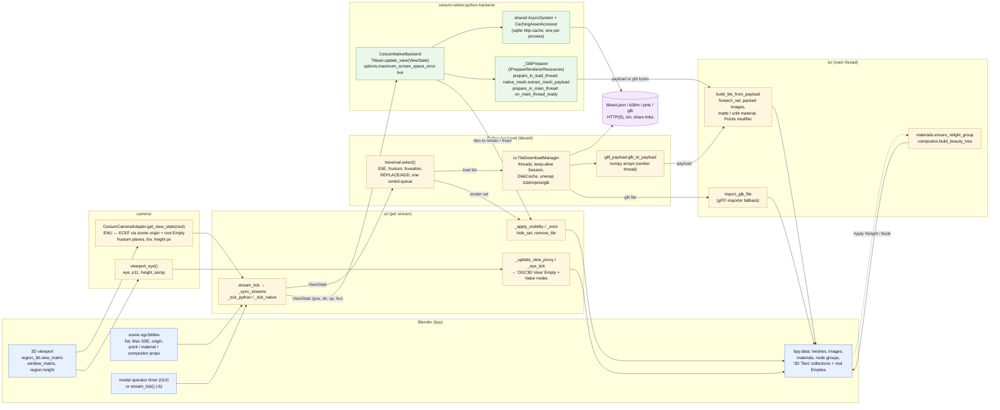

# OGC 3D Tiles Streaming — Blender Plugin

Stream OGC 3D Tiles tilesets directly into Blender with Cesium-compatible
Level-of-Detail and non-blocking HTTP downloads. Two interchangeable
backends: pure Python (always available) or cesium-native via
[cesium-native-python](https://github.com/calebbuffa/cesium-native-python).

## Architecture

```
blender_ogc3dtiles/
├── __init__.py              # bl_info, register/unregister
├── addon_prefs.py           # backend choice (AUTO / CESIUM / PYTHON), dev options
├── tileset/
│   ├── traversal.py         # Tile tree, transforms, SSE, culling, select()  (no bpy)
│   ├── backend.py           # PythonBackend + factory / probe
│   ├── native_backend.py    # cesium-native backend (real binding API)      (no bpy)
│   └── props.py             # bpy.types.Scene.ogc3dtiles PropertyGroup
├── camera/__init__.py       # viewport → ViewState (ECEF pos/dir/up, p00/p11, frustum)
├── io/__init__.py           # thread pool fetch + unwrap + disk cache, GLB import
└── ui/__init__.py           # sidebar panel + modal operator (stream_tick)
```

### Pipeline at a glance

Both backends share the same contract: every streaming tick, the add-on
reads the viewport from `bpy`, hands a `ViewState` to a *backend* that
decides which tiles to draw and which to load, and turns the content that
arrives into Blender objects.  Only the middle differs.



What each stage needs and produces:

| stage | reads | produces | thread |
|---|---|---|---|
| `camera.CesiumCameraAdapter` | viewport matrices, scene origin (lat/lon/h), root Empty transform | `ViewState` in the tileset's ECEF frame | main |
| `traversal.select` (Python) | `Tile` tree (parsed `tileset.json`, external tilesets grafted on arrival), `ViewState`, Max SSE, foveation | render set, keep set, one priority-sorted load list | main |
| `io.TileDownloadManager` | load list, token, disk cache | `FetchResult`: GLB parts (+ RTC) or external tileset JSON, numpy payloads when *Direct mesh* | worker threads |
| `CesiumNativeBackend.update_view` | `ViewState` as position / direction / up / fov | tiles to render, newly ready / freed tiles, stats | main (cesium-native pool for loads) |
| `_GlbPreparer.prepare_in_load_thread` | `Model` from cesium-native | numpy payload (`native_mesh.extract_mesh_payload`) or stripped GLB bytes | cesium-native workers |
| `io.build_tile_from_payload` / `import_glb_file` | payload or GLB file, tile matrix (`tile_world_matrix`, `apply_payload_offset` in float64) | mesh object under the root Empty, hidden until selected | main |
| `_apply_visibility` / `_evict` | render set, keep set, Max Tiles | `hide_set`, `remove_tile` | main |
| `materials` / `compositor` | tile objects, panel sliders | shared "OGC3D Relight" group, "OGC3D Beauty" compositor tree | main, on demand |

One tick, in order:

```mermaid
sequenceDiagram
    participant T as timer / stream_tick
    participant C as CesiumCameraAdapter
    participant B as backend (Python or native)
    participant W as workers (threads / cesium-native pool)
    participant IO as io (main thread)
    participant S as bpy scene

    T->>C: get_view_state(root Empty)
    C->>S: read region_3d, origin, root matrix
    C-->>T: ViewState
    T->>B: update_view(ViewState)
    B-->>T: render set, load list (Python) / ready + freed tiles (native)
    B->>W: fetch + decode (Python: TileDownloadManager; native: Tileset loads)
    W-->>IO: payload (numpy) or GLB bytes
    IO->>S: build mesh, images, material, Points modifier (budget: Imports / tick)
    T->>S: hide/show tiles, evict, move 'OGC3D View' Empty
```

### Several tilesets at once

The sidebar holds a list of tilesets (add / remove, per-entry URL, ion token
and SSE).  Every entry becomes its own stream with its own backend instance,
download manager, root Empty (`3D Tiles · <name>`) and sub-collection
(`Tiles · <name>`), all sharing the scene origin and the viewport camera.
Moving, rotating or scaling a root Empty is honoured by culling and SSE for
that tileset only.

Per row: the checkbox **pauses** the stream (nothing is loaded or evicted,
loaded tiles stay as they are), the eye hides its sub-collection (same as the
outliner).  Entries added, ticked or removed while streaming are picked up on
the next tick.  **Max SSE** (LOD sub-panel) is the live renderer setting for
every stream; tick *Own SSE* on an entry to override it for that tileset.
Both re-select immediately on both backends.  *Start* discards the tiles a
previous *Stop* left on screen (they belong to a dead selection).  Two
entries with the same label get separate collections (`… - 2`; the list
entry is renamed to match).  Editing the URL of a running entry restarts
that stream with the new URL.  **+** adds an empty entry (or one prefilled
from the URL field when that URL is not in the list yet); share links
(`/s/<token>/<asset>.json`) are labelled by the asset, never by the token.

Load order (Python backend): the tree is walked with a stack (depth-first)
but every requested tile goes into one queue that is sorted before download,
so the walk order does not matter.  The sort key is depth first (all missing
ancestors before any deeper tile), then CesiumJS-style foveated: shallow tiles first,
then by screen-space error weighted towards the view centre (*Foveation
cone* = fraction of the view half-angle); *Edge SSE relax* > 0 additionally
lets the periphery stay coarser.  cesium-native orders its own queue the same
way internally.  "Hide relation lines" (Streaming sub-panel) switches off the
dashed object→parent overlay in every 3D viewport on Start — it is a
per-viewport overlay, Blender has no per-object switch.

### Scene origin

All streams share one ENU origin (`Scene Origin` sub-panel):

- **Auto** — centre on the first tileset.  On a later Start the current origin
  is kept when the new tileset's centre lies within *Reuse within* km of it
  (default 10 km, CloudCompare-style), otherwise the scene is re-centred.
- **Keep current** — never move it once set.
- **Custom** — use the typed latitude / longitude / height.

The origin is stored in the .blend; *Reset Origin* forgets it.

### Streaming loop (both backends)

Every 50 ms the modal operator runs `ui.stream_tick()`:

1. drain worker results (external `tileset.json` are grafted into the tree,
   ready GLBs are queued),
2. import at most `Imports / tick` GLBs with `bpy.ops.import_scene.gltf`
   (the only main-thread cost; 1 keeps the viewport smooth),
3. re-run the selection only when the view changed, something arrived, or
   0.5 s passed,
4. submit loads in priority order (largest screen-space error first) up to
   the download concurrency,
5. evict least-recently-wanted hidden tiles above `Max Tiles`.

Imports never touch the user's selection or active object. Every tile is
parented to one root Empty per tileset inside the `3D Tiles` collection, so
the whole dataset can be moved / rotated / scaled, hidden or folded as one.

### Pure Python backend (`tileset/traversal.py`)

- Tile `transform` matrices compose down the tree; `box`/`sphere` volumes
  are transformed, `region` is geodetic.
- Screen-space error `sse = ge · viewport_h · p11 / (2 · dist)` with `p11`
  read from the viewport projection matrix (exact FOV, orthographic aware).
- Frustum culling with the viewport's own planes (rotated into ECEF) plus a
  maximum distance (`Max Distance`).
- Dynamic SSE: `thr(d) = SSE · (1 + d / Detail Falloff)`, so detail
  concentrates near the camera and distant regions settle at coarse LODs.
- `REPLACE` keeps the parent visible until every visible child subtree is
  imported (no holes); `ADD` renders parent and children together.
- Workers unwrap `b3dm` / `cmpt` / `glb`, trim the 8-byte container padding
  some exporters (RealityCapture) add, extract `RTC_CENTER` / `CESIUM_RTC`,
  and write GLBs into `%LOCALAPPDATA%/blender_ogc3dtiles/cache`; a second
  session of the same tileset downloads nothing.
- Placement: tile Empty = `ENU_from_ECEF · T_tile · Translate(RTC)`; Blender's
  importer already converts glTF Y-up to Z-up.

### Direct mesh construction (cesium-native, default)

`tileset/native_mesh.py` turns the decoded cesium-native `Model` into numpy
arrays on the worker thread (positions with node transforms applied and
converted to Z-up, triangle indices, per-loop UVs, normals, COLOR_0, the
original JPEG/PNG bytes of the textures or PNG re-encoded from decoded
pixels for KTX2).  `io.build_tile_from_payload` then creates the mesh with
`foreach_set`, packs the textures from bytes and builds a matte Principled
material.  Point clouds (`pnts`, glTF POINTS) become vertex-only meshes with
a `Col` colour attribute (COLOR_0 decoded straight from the buffer, ubyte /
ushort / float) and a shared Geometry Nodes modifier.  Four radius modes:
**Adaptive** (default): 0.6 × the tile's mean point spacing (5th–95th
percentile extent / point count, ignored below 64 points) × *Point scale*,
then clamped to a *Min / Max pixels* range on screen, so coarse ADD parents
get bigger points than fine children, far points never vanish and near ones
never bloat (Potree's adaptive size); **Per tile** is the same without the
pixel clamp; **Uniform** is one radius for every tile; **Screen pixels** is
radius = pixels × distance to the eye, clamped to a metre range (constant
on-screen size like 3DTilesRendererJS' point size with attenuation).  The
eye is the 'OGC3D View' Empty that the streaming tick (or, when nothing
streams, a 0.15 s timer) moves to the viewport eye and a `render_pre`
handler moves to the scene camera.  Two display modes
(`Point Clouds` sub-panel): **Point cloud** (Mesh → Points; cheapest; unlit
vertex colours in Material Preview / Rendered, material colour in Solid) and
**Tiny tetrahedra** (4 vertices per point, realised as a mesh whose active
colour attribute is `Col`, so Solid mode with Color → Attribute shows the
colours as well).  Measured main-thread cost per tile: 8–9 ms direct vs 10–13 ms
through `bpy.ops.import_scene.gltf`; the direct path also needs no temp files
and works regardless of which glTF extensions Blender's importer knows.
Toggle: "Direct mesh" in the sidebar (off = GLB re-import).

The Python backend uses the same route: `tileset/gltf_payload.py` is a pure
numpy GLB reader (any accessor type incl. KHR_mesh_quantization, interleaved
views, strips/fans/points, embedded JPEG/PNG) that runs on the download
workers (~2 ms per tile) and feeds `build_tile_from_payload`; Draco, meshopt,
KTX2 or external buffers fall back to Blender's importer.  Both producers
recentre the vertices on their float64 centroid and move the offset into the
object matrix, so content with projected-CRS or ECEF magnitudes in its node
transforms never gets quantised to float32 (0.1 m steps, view-dependent
wobble).  HTTP uses one keep-alive `requests.Session` per worker thread (TLS
handshake once per thread, not once per tile).

### cesium-native backend (`tileset/native_backend.py`)

Needs the `cesium` module (built from cesium-native-python, Python ≥ 3.12,
same minor version as Blender's interpreter). It constructs
`Tileset(TilesetExternals(CachingAssetAccessor(CurlAssetAccessor), preparer, AsyncSystem), url)`
and drives it with `update_view_group`. cesium-native does the traversal,
implicit tiling, `b3dm/i3dm/pnts/cmpt` conversion, Draco / meshopt / KTX2
decoding, the LRU tile cache (`maximum_cached_bytes`) and the sqlite HTTP
cache. Our `IPrepareRendererResources` subclass serialises each decoded
`Model` back to a GLB (`GltfUtilities.collapse_to_single_buffer` +
`GltfWriter.write_glb`, KTX2 textures re-encoded to PNG) which the same
import step consumes. Placement: Empty = `ENU_from_ECEF · T_tile · Zup→Yup`.

---

### Compositor

The "Compositor" sub-panel builds the 'OGC3D Beauty' tree on the current
scene (`compositor.py`: edges, AO, ASC-CDL grade, depth haze, glare) and
switches every 3D viewport's compositor to *Always*, so Rendered shading
shows it live; the Compositing workspace shows the nodes.  The tree holds
both edge branches; *Edges* (eye-dome lighting from depth, Sobel creases
from normals, or both), *EDL strength*, *Crease strength*, *AO* and *Haze*
drive Value nodes of the existing tree, so they update live without a
rebuild (*Rebuild* only re-derives the haze range from the loaded extent).
Viewport quirks handled: the viewport compositor's Depth pass is 0 / NaN
where nothing is drawn (sanitised to "far"), its Mist and AO passes are 1
everywhere (haze is a ramp on Depth instead), and Rendered shading lights
the scene with the world only — *Build* brightens Blender's default
dark-grey world once when the scene has no sun lamp, otherwise the tiles
look black next to Material Preview's studio HDRI.
`scripts/compositor_demo.py` reuses the same builder for headless renders.

## Coordinate System

```
WGS84 (lat/lon/height)
        │  _geodetic_to_ecef()
        ▼
    ECEF (metres, geocentric)
        │  ecef_to_enu(origin_lat, origin_lon, origin_height)
        ▼
    ENU  (East / North / Up, origin-relative metres)
        │  direct mapping
        ▼
    Blender XYZ  (X=East, Y=North, Z=Up)
```

---

## Installation

1. Zip the `src/blender_ogc3dtiles/` folder → `blender_ogc3dtiles.zip`
   (or symlink it into `extensions/user_default/`)
2. Blender → Edit → Preferences → Add-ons → Install → select zip
3. Enable "OGC 3D Tiles Streaming"
4. View3D → Sidebar (N) → "3D Tiles" tab

### cesium-native (optional)

Build the binding for the CPython minor version Blender ships (Windows: see
`docs/cesium-native-python-windows-build.md` for the fixes the upstream repo needs)
(Blender 5.1 → 3.13) and install the wheel into Blender's own
`<blender>/5.1/python/Lib/site-packages`. Then pick **CESIUM** or **AUTO**
in the add-on preferences. The pure Python path is used otherwise.

## Quick Start

1. Add a tileset entry (+) and paste a `tileset.json` URL (Cesium Ion, Google
   Maps 3D Tiles, local server, share link…)
2. For Cesium Ion: paste your access token
3. Leave the origin mode on *Auto* (first tileset centres the scene)
4. Hit **Start**
5. Navigate the 3D viewport — tiles load as you move the camera

The glTF importer (Python backend, or "Direct mesh" off) is silenced to
WARNING while tiles import; the direct mesh path prints nothing per tile.

Headless smoke test: see `ui.stream_tick()`; in `blender -b` the operator
does not start a timer, call `stream_tick(bpy.context)` yourself with a
monkeypatched `CesiumCameraAdapter.get_view_state`.

## Building the cesium-native wheel

`.github/workflows/cesium-native-wheel.yml` (manual trigger) clones
calebbuffa/cesium-native-python, applies `third_party/cesium-native-python-windows.patch`,
builds the wheel for the requested CPython (3.13 for Blender 5.1/5.2) with a
cached vcpkg tree, and uploads it as an artifact or attaches it to a release.
Blender extensions can bundle platform wheels (`wheels = [...]` in
`blender_manifest.toml`), which is the intended distribution path.

## Development

```
uv venv && uv pip install -e . --group dev
PYTHONPATH=src pytest        # traversal + coordinate tests (bpy is stubbed)
```

## Roadmap

- [x] Frustum culling, dynamic SSE, REPLACE gating, priority loads
- [x] Disk cache, budgeted imports, selection preserved
- [x] cesium-native backend against the real binding API
- [ ] Several tilesets at once (one root Empty each)
- [ ] Raster overlays (cesium-native) draped on tiles
- [x] `pnts` point clouds on the native path (Angkor tilesets verified)
- [ ] `pnts` / `i3dm` on the pure Python path
- [ ] `3DTILES_metadata` → Blender custom attributes
