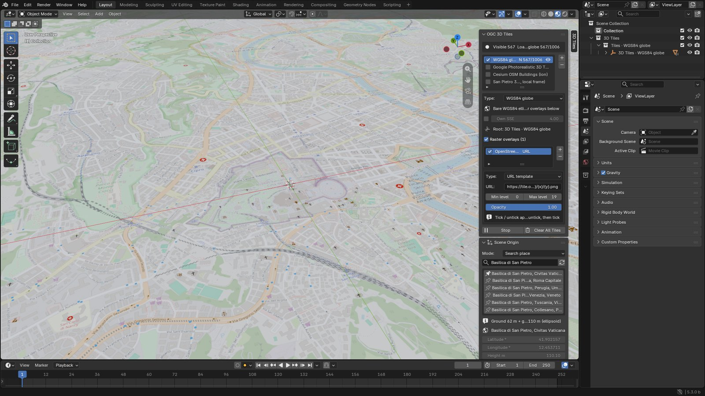
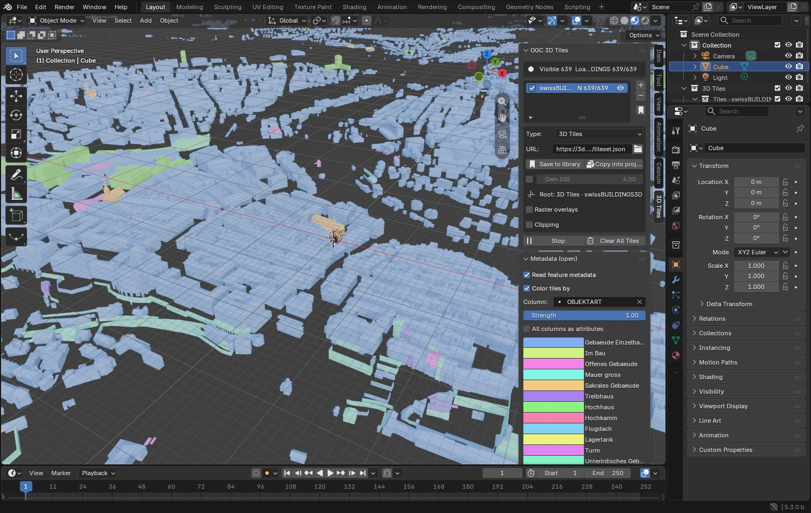
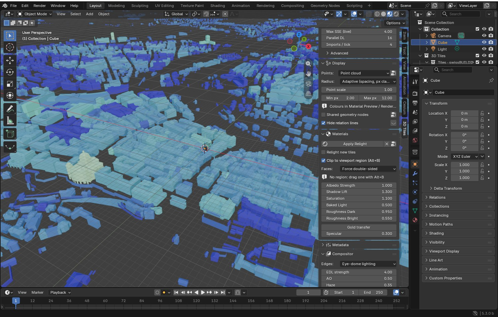
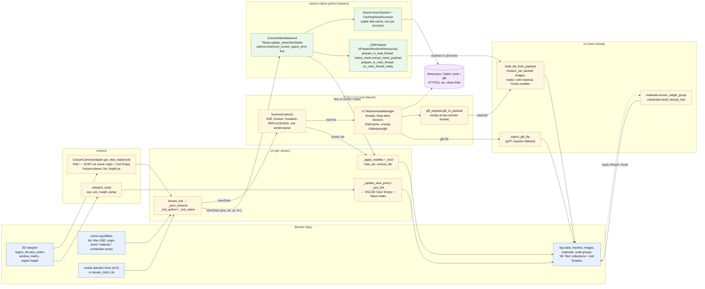
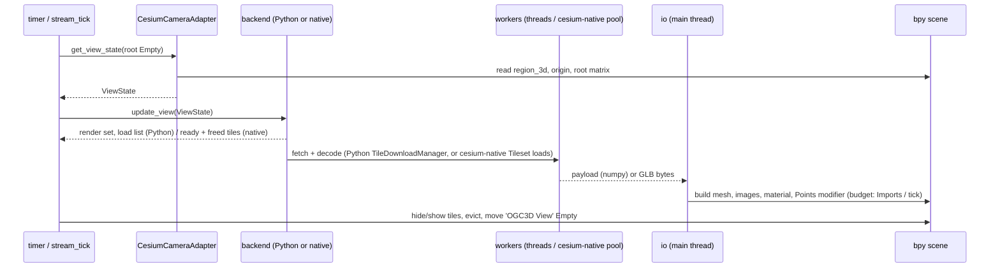

# OGC 3D Tiles Streaming — Blender Plugin

[cesium-native](https://github.com/CesiumGS/cesium-native) does the tile selection,
loading and decoding through the [cesium-native-python](https://github.com/calebbuffa/cesium-native-python)
bindings + some niceties like raster overlays or clips. Tiles load and unload around
the viewport camera, or around the render camera for animations. Different approach
than the pure-Python [CesiumForBlender](https://github.com/CognitoBit/CesiumForBlender)
([forum post](https://community.cesium.com/t/cesium-for-blender/46938))
although I keep a python native fallback.

What works today:

- **Content:** cesium-native brings for free all supported flavors of
  [3D Tiles](https://github.com/CesiumGS/3d-tiles)
  ([1.0](https://docs.ogc.org/cs/18-053r2/18-053r2.html) /
  [1.1](https://docs.ogc.org/cs/22-025r4/22-025r4.html)) and tile content:
  - Tiled meshes: b3dm, glb,
    [Draco](https://github.com/KhronosGroup/glTF/tree/main/extensions/2.0/Khronos/KHR_draco_mesh_compression),
    [meshopt](https://github.com/KhronosGroup/glTF/tree/main/extensions/2.0/Vendor/EXT_meshopt_compression),
    [KTX2](https://github.com/KhronosGroup/glTF/tree/main/extensions/2.0/Khronos/KHR_texture_basisu)
  - Tiled point clouds: `pnts`, glTF points
  - Tiled 3DGS splats:
    [`KHR_gaussian_splatting`](https://github.com/KhronosGroup/glTF/tree/main/extensions/2.0/Khronos/KHR_gaussian_splatting),
    SPZ or uncompressed, as native
    [Blender 5.3](https://developer.blender.org/docs/release_notes/5.3/rendering/) splats
  - Sources: [Google Photorealistic 3D Tiles](https://developers.google.com/maps/documentation/tile/3d-tiles),
    [Cesium ion](https://cesium.com/platform/cesium-ion/) assets, a WGS84 globe
- **One graph for all tiles:** Blender niceties there, a shared Geometry Nodes modifier,
  a shared shader group for relighting and a compositor tree (edges, AO, haze) apply to
  every tile, either content that has already been fetched and loaded or streamed later
- **Rendering:** EEVEE and Cycles, plus a "converged animation" render that waits for the
  tiles of each frame to finish loading before rendering it
- **Raster overlays** draped on tiles: URL template, TMS, WMTS, WMS, ion, Bing, Google,
  Azure, again feature-parity with all formats cesium maintains support for.
- **Clipping:** cut a tileset with Blender objects, either as clip-polygons or as 3D
  boxes, useful to combine overlapping tilesets like focus high-res drone scan into a
  coarser, larger extent, city-wide scan. It works on meshes, point clouds and splats,
  follows live as you move the objects, and can be keyframed for renders. Geometry-level
  clipping in cesium-native is requested in
  [#1486](https://github.com/CesiumGS/cesium-native/issues/1486).
- **Several tilesets at once,** placed around a scene origin usually auto-set at tileset
  centroid, or that you can set by searching for a place name; local and network-share
  tilesets, shared libraries of tilesets, and copying a tileset into the project,
  cropped to an area


## Installation

The add-on is a Blender extension (Blender 4.2 or newer; tested on 4.5 LTS,
5.1 and 5.2 LTS, native backend included).  Get `ogc_3dtiles_streaming-<version>.zip` from the
[Releases](../../releases) page, or build it from a checkout with Blender's
own packager:

```text
blender --command extension build --source-dir src/blender_ogc3dtiles --output-dir dist
blender --command extension validate dist/ogc_3dtiles_streaming-0.3.0.zip
```

Then either Preferences, Get Extensions, the drop-down arrow, *Install from
Disk*, or from a terminal:

```text
blender --command extension install-file -r user_default -e dist/ogc_3dtiles_streaming-0.3.0.zip
```

The sidebar tab "3D Tiles" appears in the 3D viewport (N).  The pure Python
backend works out of the box; for the cesium-native backend (faster, and the
only one that decodes meshopt / KTX2 content on Blender versions whose glTF
importer lacks those extensions) open the add-on preferences and press
**Install wheel from GitHub Release**, see "Installing the native backend"
below, then restart Blender.

Windows note: Blender 4.2-4.5 bundle an old MSVC runtime (14.29) and the
loader keeps it for the whole process, so a wheel linked against the dynamic
runtime of a current toolset crashes in its first mutex.  The released
Windows wheels link the runtime statically and work on 4.5 and 5.x alike; the
add-on refuses a dynamic-runtime wheel on Blender < 5.0 with a message
instead of crashing.

### Installing the native backend

The cesium-native backend is an optional wheel, `cesium-python`, built from
[cesium-native-python](https://github.com/calebbuffa/cesium-native-python).
No compiler is needed: Preferences, Add-ons, OGC 3D Tiles, **Install wheel
from GitHub Release** (also offered in the sidebar's Backend section while
the binding is missing) downloads the wheel matching Blender's CPython and
platform from the latest Release of the configured repository and
pip-installs it into Blender's Python.  The default repository is the
[jo-chemla fork](https://github.com/jo-chemla/cesium-native-python/releases)
whose CI builds Linux x86_64, Windows x64 and macOS arm64 wheels for CPython
3.11 to 3.13; switch it to the upstream repository (or to PyPI, with `pip
install cesium-python` in Blender's Python) once wheels are published there.
"Build / install from source" remains for a local checkout.

## Quick Start

1. Add a tileset entry (+) and paste a `tileset.json` URL (Cesium Ion, Google
   Maps 3D Tiles, local server, share link…)
2. For Cesium Ion: paste your access token
3. Leave the origin mode on *Auto* (first tileset centres the scene)
4. Hit **Start**
5. Navigate the 3D viewport — tiles load as you move the camera

Every section of the sidebar is its own panel (boxed, collapsible, and
re-orderable with the drag handle in its header, like the Object
Properties tabs; Blender remembers the order and the folded state).
Default order, top to bottom: tileset list and Start / Stop / Clear,
**Scene Origin** (collapsed), then **LOD / Streaming** (Max SSE, Parallel
DL, Imports / tick, and a collapsed *Advanced* sub-panel: Max Tiles,
foveation, detail falloff, max distance, direct mesh, disk cache, per-stream
backend stats), **Display** (point display and radius, relation lines),
**Materials** (relight: Apply / Remove, sliders), **Compositor** (edges and
sliders, stable viewport, Build / Remove), **Render** (collapsed), then the
collapsed **Backend** and **Coordinate Info** panels.  Defaults: Max SSE 4 px, 16 parallel downloads, 4 imports per
tick (lower it if the UI stutters while tiles pour in).  The node-tree
button next to Apply Relight, Build and the point display opens the
corresponding tree ('OGC3D Relight' shader group, 'OGC3D Beauty' compositor
tree, 'OGC3D Points…' geometry nodes) pinned in a node editor — an existing
one, or the 3D viewport split in two — so the shader or the compositor can
be adapted by hand; the sliders keep driving the same Value nodes.

The glTF importer (Python backend, or "Direct mesh" off) is silenced to
WARNING while tiles import; the direct mesh path prints nothing per tile.

## Features

### Scene origin

All streams share one ENU origin (`Scene Origin` sub-panel):

- **Auto** — centre on the first tileset.  On a later Start the current origin
  is kept when the new tileset's centre lies within *Reuse within* km of it
  (default 10 km, CloudCompare-style), otherwise the scene is re-centred.
- **Keep current** — never move it once set.
- **Custom** — use the typed latitude / longitude / height.

The origin is stored in the .blend; *Reset Origin* forgets it.

### Placing the scene origin by name



Scene Origin > Mode > *Search place*: type a place (Enter) and pick one of
the results; the origin moves there and a running stream restarts around it,
which is the quickest way to look at a spot of a global tileset (Google
Photorealistic 3D Tiles, the WGS84 globe with imagery).  Places come from
[Photon](https://photon.komoot.io) (OpenStreetMap data); the origin height is
the ground (a Terrarium elevation tile, by default the AWS open-data Terrain
Tiles) plus the EGM96 geoid undulation, i.e. an ellipsoid height as 3D Tiles
use, so the ground sits near z = 0.  The geoid grid is cesium-native's
`WW15MGH.DAC` (2 MB, fetched once into the cache).  The three endpoints are
in the add-on preferences (a self-hosted Photon works the same); the query
text is sent to the geocoder, nothing else is.

### Raster overlays


With the cesium-native backend any streamed tileset can be draped with
raster imagery, the way Cesium for Unreal / Unity do it: add entries under
*Raster overlays* in the tileset box (URL template `{z}/{x}/{y}`, TMS, WMTS,
WMS, Cesium ion imagery, Bing Maps, Google Map Tiles 2D, or cesium-native's
debug colouriser) and press Start.  cesium-native projects each tile onto
the overlay's tiling scheme, adds a `_CESIUMOVERLAY_<n>` texture-coordinate
set to the tile and streams the raster tiles that cover it at a resolution
matching the tile's screen size; the add-on turns each raster into a packed
Blender image and inserts, per tile material, a *UV Map → Mapping → Image
Texture → Mix* chain over the material's colour (also under the Relight
group).  *Opacity* is live.  Ticking / unticking an overlay while streaming
is live too: cesium-native reloads the loaded tiles with the new texture
coordinates (to apply an edited URL, untick then tick).
Several overlays stack in list order.  Overlays only make sense on surface
tiles (meshes); point clouds and Gaussian splat tiles have no texture
coordinates.  The raster images are packed into the .blend, so a saved scene
keeps its drape.


**WGS84 globe.** A tileset entry of type *WGS84 globe* streams
cesium-native's procedural ellipsoid instead of a tileset.json: a bare
globe, subdivided as the camera approaches, to drape imagery on when there
is no 3D Tiles content (the scene origin is yours to set: use *Custom*).
Terrain: cesium-native streams quantized-mesh terrain (Cesium World Terrain
on ion, or any `layer.json` server) as a tileset, so real terrain can be
draped the same way; Terrarium / Terrain-RGB raster DEMs are not terrain
providers in cesium-native and are out of scope here.

See [cesium-native: versions and upgrade notes](#cesium-native-versions-and-upgrade-notes)
for what newer cesium-native releases would add (vector overlays,
orthographic view states) once the Python binding bumps its submodule.

### Gaussian splat tiles


Tiles whose glTF carries `KHR_gaussian_splatting` (SPZ-compressed through
`KHR_gaussian_splatting_compression_spz_2`, as
[3dtiled](https://github.com/Iconem/3dtiled-to-3dtiles), the Cesium tilers
and the 3DGS-PLY-3DTiles converter write them) stream through the
cesium-native backend like any other content: cesium-native decodes the
SPZ payload and the direct-mesh path carries position, colour and opacity,
rotation, scale and the spherical-harmonic coefficients into the tile.  On
Blender 5.3 or newer, which adds native 3D Gaussian Splats
([release notes](https://developer.blender.org/docs/release_notes/5.3/rendering/)),
the tile gets the shared 'OGC3D Splats' Geometry Nodes
group (Mesh to Points, Set Point Cloud Type: 3D Gaussian Splat) and is a
native Gaussian splat point cloud, rendered by Workbench, EEVEE and Cycles
with Blender's splat pipeline.  The attribute conventions follow Blender's
SPZ importer: `radiance:base` holds the spherical-harmonic DC term plus
opacity, `scale` is in metres, `rotation` a (w, x, y, z) quaternion,
`radiance:sh_n` the higher-degree coefficients; the glTF Y-up to Z-up change
conjugates the rotation and permutes the scale axes.  Below Blender 5.3 the
same tiles show as coloured points with the usual point display modes.
LOD, scene origin, clipping, the render pipeline and the converged
animation render apply unchanged.  Blender sorts splats per object, so
where a parent and its children overlap during a REPLACE transition the
blend order between tile objects is undefined for a moment.

A tileset that is not georeferenced (its root sits at the ECEF origin, as
3dtiled and other local converters write it) is detected at start and gets an
identity frame: the tileset's own Z-up axes and metres become the Blender
scene, centred vertically.  The Scene Origin panel then reads "Local tileset".

Tested with 3dtiled output and with the public sample of the
[3D-Tiles-RendererJS 3DGS plugin](https://github.com/WilliamLiu-1997/3D-Tiles-RendererJS-3DGS-Plugin)
(`data/Elevator-3dtiles/tileset.json` on raw.githubusercontent.com, degree-3
spherical harmonics).

### Clipping

Each tileset entry has a **Clipping** list of Blender objects. **+** adds the
selected meshes or curves; each one is either:

- a **Clip-polygon**: its outlines seen from above, extruded along the tileset frame's Z
  (ENU up at the scene origin). An outline is every closed loop of boundary edges,
  or every edge of a face-less mesh or curve, so one object can hold several
  polygons. To make one, draw a Circle or Plane mesh, a polyline or a closed curve
  in Top view;
- a **Box**: the object's bounding box with its location, rotation and
  scale, so it clips in 3D (cut the top floors of a building, or a slab of a
  point cloud). Cube-like meshes are added as boxes.

The mode combines the volumes:

| Mode | Removes | |
|---|---|---|
| Cut inside any | what is inside at least one volume | union cut |
| Cut inside all | what is inside every volume | overlap cut |
| Keep inside any | what is outside every volume (*outside all*) | union kept |
| Keep inside all | what is outside at least one volume (*outside any*) | overlap kept |

Meshes, point clouds and Gaussian splats are clipped. Moving, rotating or
scaling a box or a clip-polygon updates the cut live, with no tile reloaded
(outlines over 64 points are cesium masks, which do reload them). Objects without
a parent are parented to the tileset's root Empty, so they follow it.
Tiles entirely cut by the
volumes aren't downloaded.

On mesh tiles the cut is done in the material, so Solid view, snapping and
exports still see the full mesh. **Cut Geometry** also deletes the faces that
are entirely cut, with Geometry Nodes and without fetching anything again. Faces
across the boundary stay whole outside the Material and Rendered views. It's off
by default because it slows down dragging a box on large scenes. Point clouds
and splats always lose the cut points for real.

Switching mode is close to instant: no material changes. See
[docs/clipping.md](docs/clipping.md) for how it all works, what comes from
cesium-native, and measurements.

### Several tilesets at once

The sidebar opens on the **3D Tiles** tab when Blender starts or a file loads (a
preference turns that off). It holds a list of tilesets (add / remove, per-entry type, source
and SSE).  An entry is one of three types: **3D Tiles** (a `tileset.json`
URL or local path), **Cesium ion** (asset id and access token; the token is
only sent to Cesium ion) or **WGS84 globe** (cesium-native's procedural
ellipsoid, a bare globe to drape imagery on).  Each entry has a *Raster
overlays* checkbox, off for 3D Tiles and ion entries and switched on when
the type becomes globe; the overlay list only shows when it is ticked, and
ticking it while streaming adds or removes the overlays live.  Ion and globe
entries need the cesium-native backend.


Every entry becomes its own stream with its own backend instance,
download manager, root Empty (`3D Tiles · <name>`) and sub-collection
(`Tiles · <name>`), all sharing the scene origin and the viewport camera.
Moving, rotating or scaling a root Empty is honoured by culling and SSE for
that tileset only.

Per row: the checkbox **pauses** the stream (nothing is loaded or evicted,
loaded tiles stay as they are), the eye hides its sub-collection (same as the
outliner).  Entries added, ticked or removed while streaming are picked up on
the next tick.  **Max SSE** (LOD / Streaming sub-panel) is the live renderer setting for
every stream; tick *Own SSE* on an entry to override it for that tileset.
Both re-select immediately on both backends.  *Start* discards the tiles a
previous *Stop* left on screen (they belong to a dead selection).  Two
entries with the same label get separate collections (`… - 2`; the list
entry is renamed to match).  Editing the URL of a running entry restarts
that stream with the new URL.  **+** adds an empty entry (or one prefilled
from the URL field when that URL is not in the list yet); share links
(`/s/<token>/<asset>.json`) are labelled by the asset, never by the token.

Load order (Python backend): the tree is walked with a stack (depth-first)
but every requested tile goes into one queue that is sorted before download,
so the walk order does not matter.  The sort key is depth first (all missing
ancestors before any deeper tile), then CesiumJS-style foveated: shallow tiles first,
then by screen-space error weighted towards the view centre (*Foveation
cone* = fraction of the view half-angle); *Edge SSE relax* > 0 additionally
lets the periphery stay coarser.  cesium-native orders its own queue the same
way internally.  "Hide relation lines" (Display sub-panel) switches off the
dashed object→parent overlay in every 3D viewport on Start — it is a
per-viewport overlay, Blender has no per-object switch.

### Local and network tilesets, libraries, copies

**Local files and NAS shares.** cesium-native's curl does not accept bare
paths. Measured with the binding: `C:\x\tileset.json`, `\\nas\share\...` and
`file://nas/share/...` all fail. `file:///C:/x/tileset.json` and
`file:////nas/share/x/tileset.json` (four slashes for UNC) work, and relative
content URIs resolve against both. The URL field therefore takes any of:
- a URL;
- a plain path (`C:\...`, `\\nas\share\...`);
- a blend-relative `//tilesets/site/tileset.json`.

Plain and blend-relative paths are turned into the working `file:` form when
the stream starts. The folder button next to the URL opens Blender's file
browser (type `\\server\share` in its path field to reach a share). With
*Relative Path* ticked it stores a blend-relative path. Otherwise it stores a
`file:` URL, with mapped drives (`Z:`) replaced by their UNC share (see
*Mapped drives as UNC* in Preferences), so the entry works on machines that
map the share to another letter. `file:` reads are never cached (see below),
so a NAS tileset is read over the network every time it streams. Copy it
into the project for heavy use.

**Disk cache.** cesium-native caches HTTP responses in an sqlite file:
`tileset.json`, tile content (b3dm, glb, pnts) and imagery, as downloaded,
not decoded meshes. It stores a response only when the server allows it:
`Cache-Control: max-age`, a future `Expires`, or an `ETag` /
`Last-Modified` to revalidate with. The cache key is the full URL, so
Google's per-session URLs miss across sessions. The binding keeps at most
4096 responses. Preferences hold the **Cache folder** (default
`%LOCALAPPDATA%\blender_ogc3dtiles\cache`) and a **Cache size cap** (GB). The
cap is enforced least-recently-used first when the first stream of a session
starts, or with the brush button. Keep the cache on a local disk: sqlite
locking over SMB is unreliable, and the keys include share-link tokens.
Private databases left by other Blender processes are deleted after a day.

**Tileset libraries.** Preferences list one or more JSON files
(`;`-separated), for example a personal one and a team one on the NAS.
*Save to library* writes the active entry (URL, type, ion id / token, SSE,
overlays and their keys) under its name, replacing an entry of the same
name. It re-reads the file just before writing and replaces it atomically.
The bookmark button under the tileset list adds an entry from any library
through a search popup, optionally only meshes, point clouds or splats (an entry's
`content` field, else guessed from its words). A .blend keeps the entry's URL once added, so it
still opens if the library entry goes away.

**Copy into project.** It copies the active tileset (explicit tilesets,
external tilesets followed) into a folder, by default
`//tilesets/<name>` next to the .blend. It can crop to the bounding box of an
object; a flat object crops its footprint at any height. It can also stop at
a coarsest *Finest error* (geometric error in metres, which drops deeper
levels). Kept tiles are downloaded in parallel. A re-run resumes and skips
files already there. *Stream the copy* points the entry at it when done.
Query strings and share-link tokens are never written into the copy (its
`export.json` records only scheme, host and file name). Google tiles work
(the `key` and `session` parameters are carried down the tree, never written;
Google's terms forbid storing tiles offline, so keep such copies to tests),
as do Cesium ion assets (resolved with the entry's token, which never lands
on disk). Implicit tilesets (quadtree / octree, binary or JSON subtrees) are
written out as explicit ones, cropped while walking the subtrees; S2 volumes
and subtree metadata are not supported.

### Point clouds

Point clouds (`pnts`, glTF POINTS) become vertex-only meshes with
a `Col` colour attribute (COLOR_0 decoded straight from the buffer, ubyte /
ushort / float) and a shared Geometry Nodes modifier.  Four radius modes:
**Adaptive** (default): 0.6 × the tile's mean point spacing (5th–95th
percentile extent / point count, ignored below 64 points) × *Point scale*,
clamped to a *Min / Max pixels* range measured at the **view pivot
distance** (eye → orbit centre in the viewport, camera → point tiles when
rendering).  One distance for the whole scene means every tile of one LOD
level gets the same radius, and the two metre bounds are plain Value nodes
rewritten only when the distance moves by more than 15 %, so the point
tiles re-evaluate while zooming, never while orbiting (Potree's adaptive
size); **Per tile** is the same without the pixel clamp; **Uniform** is one
radius for every tile; **Screen pixels** is the exact per-point version,
radius = pixels × distance to the eye, clamped to a metre range (constant
on-screen size like 3DTilesRendererJS' point size with attenuation) — this
one reads the eye from the 'OGC3D View' Empty, so every point tile
re-evaluates whenever the eye moves.  The streaming tick (or, when nothing
streams, a 0.15 s timer) feeds the viewport, a `render_pre` handler the
scene camera.  Three display modes
(`Display` sub-panel): **Point cloud** (Mesh → Points; cheapest; unlit
vertex colours in Material Preview / Rendered, material colour in Solid),
**Tiny tetrahedra** (4 vertices per point, realised as a mesh whose active
colour attribute is `Col`, so Solid mode with Color → Attribute shows the
colours as well) and **Disc splats** (an 8-gon disc instanced on every
point, not realised; oriented along the point's glTF normal when the tile
has one — kept as the `ogc3d_normal` attribute — otherwise facing the view
through a shared "View Dir" vector refreshed per tick / render; the point
material reads `Col` through both a Geometry and an Instancer Attribute
node, since instance attributes only reach EEVEE through the latter).

### Feature metadata

Tiles often carry a table with one row per feature: building type, year, height. With
**Read feature metadata** on (Metadata panel, before Start), the add-on reads these
`EXT_structural_metadata` tables, including b3dm batch tables, which cesium-native
converts. It needs the cesium-native backend and Direct mesh.

Each tile gets an `ogc3d_feature` vertex attribute (the row) and a `meta_<column>`
attribute for the active column, which shaders and Geometry Nodes can read. *All columns
as attributes* keeps the others too, at about 40 MB per column on 10 M vertices. Text
columns become integer classes shared by all tiles. The full table stays on the tile
object as JSON, in the `ogc3d_features` custom property, for lookups by feature id.

**Color tiles by** mixes colors into every tile material through the shared
'OGC3D Metadata' group: one editable color per class for text, a Color Ramp between the
column's min and max for numbers. Measured on swissBUILDINGS3D over Bern, 608 tiles:
about 10 ms per tile on the worker threads, 2.7 MB of JSON for 468 tiles on screen, and
0.5 s to switch to another column. Columns that differ on every row, like UUIDs, stay in
the table only.





**Point clouds** work the same way, per point: `EXT_structural_metadata` property
attributes and `pnts` batch tables without `BATCH_ID` always become `meta_<column>`
attributes (a table of millions of rows wouldn't fit a Python list). Whole numbers with
few values and enums are classes, named when the schema has an enum; other values go
through the ramp. Batched `pnts` use the table path above.

**Tileset, group, tile and content metadata** are read from `tileset.json`. The tileset's
own values show in the Metadata panel; the others, merged per tile, are in the
`ogc3d_tile_metadata` custom property as JSON.

With raster overlays, the metadata colors stay on top: lower **Strength** to see the map
through them.

**Textures** can hold metadata per pixel: feature id textures point at table rows, and
property textures hold the values directly. The column in use becomes one image per tile,
sampled in its material with Closest interpolation, on the mesh's first UV set. Only 8-bit
channels are read.

Not read yet: vector columns (the binding can't convert them on v0.59), and tile metadata
stored in implicit subtrees.

### Voxels

Voxel tilesets (`3DTILES_content_voxels`, `EXT_primitive_voxels`) stream like any other
tileset: cesium-native selects the tiles for the view. Their values reach the Metadata
panel as columns, so classes, legend and ramp work the same, and they turn on by
themselves at the first voxel tile. Tested on [GeoTOP](https://bedrock.engineer/geotop-voxels/),
the Dutch geological model, with 73 tiles over Amsterdam.

The **Voxels** setting (Metadata panel, before Start) picks how they show:

- **Blocks**: a mesh of the cell faces next to empty space. Crisp and opaque. Best for
  classes. About 50,000 faces and 80 ms per tile on
  GeoTOP.
- **Volume (see-through)**: one OpenVDB Volume per tile, with **Volume opacity**. Soft,
  because Blender has no nearest sampling for Volumes, so better for continuous fields.
  Box tiles only, no clipping.

- **Color other tilesets**: nothing is drawn for the voxel tiles. Every other tile's
  material reads the voxel under each pixel from its world position, so a scan keeps its
  geometry and its texture or vertex color, and **Voxel color** mixes in the class. **Keep
  only inside voxels** makes the pixels outside transparent: a boolean intersect that
  doesn't touch the geometry. Box tiles only.

**Voxel height scale** stretches thin datasets vertically (GeoTOP is 62 m thick over
33 km); stretched tiles no longer line up with other data. Both settings apply at the
next Start. Box and region tiles work; cylinder tiles are skipped. See
[docs/voxels.md](docs/voxels.md) for the measurements.

### Editing tile geometry

**Shared geometry nodes** (Display section) puts one Geometry Nodes
modifier, 'OGC3D Tile Geometry', first in the modifier stack of every tile
mesh, loaded or streamed later, so a single graph edits the vertices, edges
or attributes of all tiles (the point display modifier runs after it).  The
group starts as a pass-through; the node-tree button opens it pinned in a
node editor.  Untick to remove the modifier from every tile; the group stays
in the file for the next time.

### Compositor

The "Compositor" sub-panel builds the 'OGC3D Beauty' tree on the current
scene (`compositor.py`: edges, AO, ASC-CDL grade, depth haze, glare) and
switches every 3D viewport's compositor to *Always*, so Rendered shading
shows it live; the Compositing workspace shows the nodes.  The tree holds
both edge branches; *Edges* (eye-dome lighting from depth, Sobel creases
from normals, or both), *EDL strength*, *Crease strength*, *AO* and *Haze*
drive Value nodes of the existing tree, so they update live without a
rebuild (*Rebuild* only re-derives the haze range from the loaded extent).
Viewport quirks handled: the viewport compositor's Depth pass is 0 / NaN
where nothing is drawn (sanitised to "far"), its Mist and AO passes are 1
everywhere (haze is a ramp on Depth instead), and Rendered shading lights
the scene with the world only — *Build* brightens Blender's default
dark-grey world once when the scene has no sun lamp, otherwise the tiles
look black next to Material Preview's studio HDRI.  *Stable viewport*
(default on) renders the viewport with one TAA sample while the tree is
built: EEVEE jitters every accumulated sample by a sub-pixel offset and the
Depth / Normal passes are not accumulated, so EDL and creases shimmer by a
pixel in four directions until the view converges; one sample removes the
shimmer at the cost of viewport anti-aliasing (Remove restores the count).
`scripts/compositor_demo.py` reuses the same builder for headless renders.

### Rendering animations with converged tiles

Blender cannot pause inside a render to wait for tiles: streaming advances
on the UI timer, which stops while a frame renders, so *Render Animation*
renders whatever happens to be loaded.  The **Render** section does it the
other way round:

- **Stream for**: *3D viewport* (interactive, default) or *Scene camera*,
  which selects tiles for the active camera at the render resolution, so
  scrubbing the timeline re-selects tiles along the camera path.
- **Render converged animation** steps through the frame range from the
  scene camera.  The first frame waits at least *Warm-up s* (default 10:
  empty scene, cold cache).  Every frame then waits until the download /
  build queue is empty and nothing has changed for *Settle s* (or until
  *Max wait s* has passed), renders the frame with the scene's output settings to the
  Output path (one file per frame, like Render Animation), then moves on.
  ESC cancels; the sidebar shows the frame, the queue length and how long
  the scene has been quiet.  Streaming starts if it is not running, and the
  stream mode is restored afterwards.

Rule of thumb for *Settle s*: the time the viewport usually takes to stop
changing after you jump the camera, plus a margin; one or two seconds on a
local cache, more over a slow link.  Lower *Max SSE* before rendering if
you want finer tiles than you use interactively.

### Cycles viewport

Cycles restarts its viewport render whenever the scene is tagged for update.
The add-on therefore keeps the per-tick status line out of scene properties
and only redraws the sidebar; tiles appearing or disappearing still restart
it, which is unavoidable.  If "GPU Compute" is greyed out in the render
device selector, no device is ticked under Preferences, System, Cycles
Render Devices (CUDA / OptiX / HIP / oneAPI / Metal).

### Orthographic viewports and the clip range

The Python traversal reads the orthographic projection directly (SSE =
`ge · viewport_h / frame_height`, no distance term).  cesium-native only
knows perspective cameras, so for an orthographic viewport the adapter hands
it a 1-degree camera pulled back far enough that its frame at the view pivot
matches the orthographic frame: same screen-space error, same tiles, instead
of the thin cone / inflated SSE an un-adjusted 1-degree camera gives
(`ViewState.native_position`, `ortho_eye_offset`).  cesium-native fog
culling is off (it is height-based and would cull that far eye's view).

When a tileset root arrives the add-on sizes every 3D viewport's clip range
to it: clip end = 6 x the root radius, clamped to 1 km - 200 km, clip start
raised to clip end / 1e6; camera objects get the same clip end when theirs
is smaller (the 100 m default renders a site-scale tileset as empty).  The fixed 1e6 m clip end of earlier versions had
two side effects: Blender's clipping region (Alt+B) computes its planes in
single precision from the near and far corners, and past a far / near ratio
of about 1e7 the planes come out NaN (nothing is clipped, or a flat slab is);
and orthographic depth, which spans the whole clip range linearly, dropped to
centimetre precision.  Raise the clip end by hand for globe-scale tilesets;
keep clip start above clip end / 1e7 if you use Alt+B.  The clipping region
only affects drawing, not which tiles stream, and in Blender 5.1 only Solid
and Wireframe shading honour it: EEVEE (Material Preview, Rendered) ignores
the clipping region on any scene, add-on or not.  **Clip to viewport region**
(Materials section) works around that: every tile material gets a Mix Shader
to a Transparent BSDF driven by the shared 'OGC3D Clip' group, into which the
add-on copies the viewport's clip planes each tick.  While it is on, Alt+B
alone toggles the clipping (drag a region to clip, Alt+B again to clear);
the planes come from the largest 3D viewport, and F12 renders use whatever
region that viewport last had.  It is on by default; untick to remove the
nodes again.  **Faces** below it sets back-face handling for every tile
material (EEVEE and Cycles): *Force double-sided* (default: clipped or open
meshes show their inside), *Force single-sided*, or *Material setting*,
which restores what the tile declared (glTF `doubleSided`; most
photogrammetry exports are single-sided, which is why tiles used to vanish
from behind).

## Development

### Setup and tests

```
uv venv && uv pip install -e . --group dev
PYTHONPATH=src pytest        # traversal + coordinate tests (bpy is stubbed)
```

For development, symlink `src/blender_ogc3dtiles` into
`<config>/extensions/user_default/` and use `scripts/dev_blender.ps1`.

Headless smoke test: see `ui.stream_tick()`; in `blender -b` the operator
does not start a timer, call `stream_tick(bpy.context)` yourself with a
monkeypatched `CesiumCameraAdapter.get_view_state`.

### Architecture

Stream OGC 3D Tiles tilesets directly into Blender with Cesium-compatible
Level-of-Detail and non-blocking HTTP downloads. Two interchangeable
backends: pure Python (always available) or cesium-native via
[cesium-native-python](https://github.com/calebbuffa/cesium-native-python).

```
blender_ogc3dtiles/
├── __init__.py              # bl_info, register/unregister
├── addon_prefs.py           # backend choice (AUTO / CESIUM / PYTHON), dev options
├── tileset/
│   ├── traversal.py         # Tile tree, transforms, SSE, culling, select()  (no bpy)
│   ├── backend.py           # PythonBackend + factory / probe
│   ├── native_backend.py    # cesium-native backend (real binding API)      (no bpy)
│   └── props.py             # bpy.types.Scene.ogc3dtiles PropertyGroup
├── camera/__init__.py       # viewport → ViewState (ECEF pos/dir/up, p00/p11, frustum)
├── io/__init__.py           # thread pool fetch + unwrap + disk cache, GLB import
└── ui/__init__.py           # sidebar panel + modal operator (stream_tick)
```

#### Pipeline at a glance

Both backends share the same contract: every streaming tick, the add-on
reads the viewport from `bpy`, hands a `ViewState` to a *backend* that
decides which tiles to draw and which to load, and turns the content that
arrives into Blender objects.  Only the middle differs.



What each stage needs and produces:

| stage | reads | produces | thread |
|---|---|---|---|
| `camera.CesiumCameraAdapter` | viewport matrices, scene origin (lat/lon/h), root Empty transform | `ViewState` in the tileset's ECEF frame | main |
| `traversal.select` (Python) | `Tile` tree (parsed `tileset.json`, external tilesets grafted on arrival), `ViewState`, Max SSE, foveation | render set, keep set, one priority-sorted load list | main |
| `io.TileDownloadManager` | load list, token, disk cache | `FetchResult`: GLB parts (+ RTC) or external tileset JSON, numpy payloads when *Direct mesh* | worker threads |
| `CesiumNativeBackend.update_view` | `ViewState` as position / direction / up / fov | tiles to render, newly ready / freed tiles, stats | main (cesium-native pool for loads) |
| `_GlbPreparer.prepare_in_load_thread` | `Model` from cesium-native | numpy payload (`native_mesh.extract_mesh_payload`) or stripped GLB bytes | cesium-native workers |
| `io.build_tile_from_payload` / `import_glb_file` | payload or GLB file, tile matrix (`tile_world_matrix`, `apply_payload_offset` in float64) | mesh object under the root Empty, hidden until selected | main |
| `_apply_visibility` / `_evict` | render set, keep set, Max Tiles | `hide_set`, `remove_tile` | main |
| `materials` / `compositor` | tile objects, panel sliders | shared "OGC3D Relight" group, "OGC3D Beauty" compositor tree | main, on demand |

One tick, in order:



#### Streaming loop (both backends)

Every 50 ms the modal operator runs `ui.stream_tick()`:

1. drain worker results (external `tileset.json` are grafted into the tree,
   ready GLBs are queued),
2. import at most `Imports / tick` GLBs with `bpy.ops.import_scene.gltf`
   (the only main-thread cost; 1 keeps the viewport smooth),
3. re-run the selection only when the view changed, something arrived, or
   0.5 s passed,
4. submit loads in priority order (largest screen-space error first) up to
   the download concurrency,
5. evict least-recently-wanted hidden tiles above `Max Tiles`.

Imports never touch the user's selection or active object. Every tile is
parented to one root Empty per tileset inside the `3D Tiles` collection, so
the whole dataset can be moved / rotated / scaled, hidden or folded as one.

#### What keeps Blender busy while streaming

Everything that touches `bpy` runs on Blender's main thread, between
redraws: building tile meshes and materials, attaching overlay rasters,
deleting evicted tiles, and cesium-native's tile selection (about 20 ms per
update for Google Photorealistic 3D Tiles).  Downloads and glTF decoding
run in worker threads.  Measured on Google tiles over Rome, about 550 tiles
on screen, Blender 5.3, orbiting view:

| | redraw interval |
|---|---|
| streaming, default budget | 87 ms |
| streaming, view moving (navigation budget 8 ms) | 36 ms |
| stopped, Solid | 10 ms |
| stopped, Material Preview | 23 ms |
| stopped, Rendered (EEVEE) | 147 ms |

The knobs: *Imports / tick* is the build budget when the view rests
(12 ms per import); *Build ms while navigating* (LOD / Streaming > Advanced)
is the budget while the view moves and 0.3 s after, so orbiting stays fluid
and loading catches up when you stop; Solid shading draws fastest; with
raster overlays, *Raster detail* trades imagery resolution for fewer
downloads (cesium-native shows a tile only once all its rasters are in).
Tiles are deleted in one `bpy.data.batch_remove` per tick (deleting them one
by one is quadratic in the number of objects), so a restart or *Clear All
Tiles* takes well under a second.

#### Pure Python backend (`tileset/traversal.py`)

- Tile `transform` matrices compose down the tree; `box`/`sphere` volumes
  are transformed, `region` is geodetic.
- Screen-space error `sse = ge · viewport_h · p11 / (2 · dist)` with `p11`
  read from the viewport projection matrix (exact FOV, orthographic aware).
- Frustum culling with the viewport's own planes (rotated into ECEF) plus a
  maximum distance (`Max Distance`).
- Dynamic SSE: `thr(d) = SSE · (1 + d / Detail Falloff)`, so detail
  concentrates near the camera and distant regions settle at coarse LODs.
- `REPLACE` keeps the parent visible until every visible child subtree is
  imported (no holes); `ADD` renders parent and children together.
- Workers unwrap `b3dm` / `cmpt` / `glb`, trim the 8-byte container padding
  some exporters (RealityCapture) add, extract `RTC_CENTER` / `CESIUM_RTC`,
  and write GLBs into `%LOCALAPPDATA%/blender_ogc3dtiles/cache`; a second
  session of the same tileset downloads nothing.
- Placement: tile Empty = `ENU_from_ECEF · T_tile · Translate(RTC)`; Blender's
  importer already converts glTF Y-up to Z-up.

#### Direct mesh construction (cesium-native, default)

`tileset/native_mesh.py` turns the decoded cesium-native `Model` into numpy
arrays on the worker thread (positions with node transforms applied and
converted to Z-up, triangle indices, per-loop UVs, normals, COLOR_0, the
original JPEG/PNG bytes of the textures or PNG re-encoded from decoded
pixels for KTX2).  `io.build_tile_from_payload` then creates the mesh with
`foreach_set`, packs the textures from bytes and builds a matte Principled
material.  Point clouds become vertex-only meshes, see [Point clouds](#point-clouds).
Measured main-thread cost per tile: 8–9 ms direct vs 10–13 ms
through `bpy.ops.import_scene.gltf`; the direct path also needs no temp files
and works regardless of which glTF extensions Blender's importer knows.
Toggle: "Direct mesh" in the sidebar (off = GLB re-import).

The Python backend uses the same route: `tileset/gltf_payload.py` is a pure
numpy GLB reader (any accessor type incl. KHR_mesh_quantization, interleaved
views, strips/fans/points, embedded JPEG/PNG) that runs on the download
workers (~2 ms per tile) and feeds `build_tile_from_payload`; Draco, meshopt,
KTX2 or external buffers fall back to Blender's importer.  Both producers
recentre the vertices on their float64 centroid and move the offset into the
object matrix, so content with projected-CRS or ECEF magnitudes in its node
transforms never gets quantised to float32 (0.1 m steps, view-dependent
wobble).  HTTP uses one keep-alive `requests.Session` per worker thread (TLS
handshake once per thread, not once per tile).

#### cesium-native backend (`tileset/native_backend.py`)

Needs the `cesium` module (built from cesium-native-python, Python ≥ 3.12,
same minor version as Blender's interpreter). It constructs
`Tileset(TilesetExternals(CachingAssetAccessor(CurlAssetAccessor), preparer, AsyncSystem), url)`
and drives it with `update_view_group`. cesium-native does the traversal,
implicit tiling, `b3dm/i3dm/pnts/cmpt` conversion, Draco / meshopt / KTX2
decoding, the LRU tile cache (`maximum_cached_bytes`) and the sqlite HTTP
cache. Our `IPrepareRendererResources` subclass serialises each decoded
`Model` back to a GLB (`GltfUtilities.collapse_to_single_buffer` +
`GltfWriter.write_glb`, KTX2 textures re-encoded to PNG) which the same
import step consumes. Placement: Empty = `ENU_from_ECEF · T_tile · Zup→Yup`.

#### Coordinate system

```
WGS84 (lat/lon/height)
        │  _geodetic_to_ecef()
        ▼
    ECEF (metres, geocentric)
        │  ecef_to_enu(origin_lat, origin_lon, origin_height)
        ▼
    ENU  (East / North / Up, origin-relative metres)
        │  direct mapping
        ▼
    Blender XYZ  (X=East, Y=North, Z=Up)
```

### Building the cesium-native wheel

The add-on installs pre-built wheels (see
[Installing the native backend](#installing-the-native-backend)).  The build
fixes for Windows, manylinux and macOS were merged upstream
([cesium-native-python#3](https://github.com/calebbuffa/cesium-native-python/pull/3),
October 2026), so `pip install .` works from a plain checkout; the
cibuildwheel workflow that publishes wheels
([#4](https://github.com/calebbuffa/cesium-native-python/pull/4)) is under
review, and the jo-chemla fork publishes them meanwhile.  This repository's
manual `cesium-native-wheel.yml` workflow predates both.

### cesium-native: versions and upgrade notes

#### What vcpkg is, and why the wheel takes hours to build the first time

[vcpkg](https://vcpkg.io) is Microsoft's C/C++ package manager: a recipe
("port") per library that downloads its sources and builds them for the
target platform and compiler.  cesium-native declares its dependencies in a
`vcpkg.json` and pulls them through vcpkg (via its `ezvcpkg` CMake wrapper):
thirty direct dependencies (Draco, meshoptimizer, KTX, libjpeg-turbo,
libwebp, zlib-ng, zstd, OpenSSL, curl, sqlite3, s2geometry, tinyxml2,
blend2d, glm, spz, ...) plus their own, such as abseil for s2geometry.  They are compiled from source, which is why a cold
wheel build takes one to three hours per OS, and why the CI caches the
built vcpkg tree (later builds only compile the bindings, about 15 minutes).
vcpkg pins all libraries together through a *baseline* (a commit of the
vcpkg ports registry): moving the baseline upgrades every dependency at once,
which is what makes some cesium-native upgrades expensive for the binding.

#### Vendored version vs upstream

The Python binding vendors cesium-native as a git submodule.

| | version | date |
|---|---|---|
| vendored by cesium-native-python (`extern/cesium-native`) | v0.59.0 | 2026-03-31 |
| latest cesium-native release at the time of writing (2026-10-23) | v0.65.0 | 2026-10-01 |

Already in v0.59.0 and used by the add-on: `KHR_gaussian_splatting` with SPZ
decoding (v0.56.0, release-candidate classes in v0.58.0), raster overlays
(TMS / WMTS / WMS / URL template / ion / Bing / Google / Azure), the
ellipsoid tileset loader, Draco / meshopt / KTX2 decoding, quantized-mesh
terrain, implicit tiling.

| release | for the add-on | upstream changes |
|---|---|---|
| v0.60.0 (2026-05) | — | `MAXAR_content_geojson` (Maxar vendor extension: GeoJSON files as tile content, with a properties schema), `BoundingRegionBuilder::expandToIncludeBoundingRegion`, GeoJSON overlay style fix. |
| v0.61.0 (2026-06) | vector overlays | `VectorTilesRasterOverlay` (a 3D Tiles vector tileset rasterised with a style and draped like imagery), overlays draw points, `3DTILES_content_conditional`, `EXT_mesh_primitive_edge_visibility`, MAXAR feature ids. Breaking: `GeoJsonDocumentRasterOverlay` moved to `CesiumVectorOverlays`. |
| v0.62.0 (2026-07) | **binding work** | Breaking: vcpkg baseline upgrade, image types moved to a new `CesiumImage` library, position / normal / accessor APIs changed (variant types, `normalized` argument). Adds accessor visitors (position, normal, quaternion, colour), primitive-mode retopologising, `KHR_billboard`, `KHR_mesh_quantization` texcoord types, GeoJSON properties as structural metadata. |
| v0.63.0 (2026-08) | — | `KHR_lights_punctual`, Bentley line / point style materials, GeoJSON point rasterising fix, MAXAR string offsets fix. |
| v0.64.0 (2026-09) | **orthographic views** | `ViewState` accepts general culling volumes (not only a perspective frustum), intersection tests on `BoundingVolume`, area paging for fixed-LOD terrain regions. |
| v0.65.0 (2026-10) | **orthographic views**, robustness | Breaking: `ViewState` takes a delegate computing the tile screen-space error (replaces the fixed geometric-error setter). Fixes: Draco out-of-bounds read, PNTS section length check. `GS_3DT` iTwin reality data, styling provider for `VectorTilesRasterOverlay`. |
| v0.66.0 (2026-11) | security fix | Integer overflow / out-of-bounds write when decoding `EXT_meshopt_compression`; experimental glTF 2.1 and 3D Tiles 2.0; `CESIUM_DISABLE_SPZ` build option; `KHR_implicit_shapes` classes renamed. |

Reading: the meshopt fix is a reason to bump even without new features;
v0.62 is the release that makes the bump expensive (vcpkg baseline, image
and accessor API changes touch most of the binding); v0.64 / v0.65 are the
ones the add-on would use first.  Source:
[cesium-native CHANGES.md](https://github.com/CesiumGS/cesium-native/blob/main/CHANGES.md).

#### Non-perspective cameras (orthographic, panoramic)

cesium-native v0.59 selects tiles for perspective views only: a frustum for
culling and the perspective screen-space error formula.  The add-on emulates
an orthographic viewport with a far, narrow perspective eye.  With v0.64's
culling volumes and v0.65's screen-space-error delegate, a renderer defines
both itself, so a real orthographic view becomes possible (an oriented box
for culling, error = geometric error / ortho scale × pixels).  The same
applies to Blender's panoramic cameras: an equirectangular camera sees all
directions (cull nothing but distance) and has a constant angular
resolution, so its error is geometric error / distance × width / 2π; a
cylindrical camera mixes the two.  Until then, a panorama can already be
approximated with today's API, since `update_view_group` accepts several
view states: six 90° perspective views of a cube map, whose union is the
selection.

#### Tiled formats cesium-native reads, and what needs a converter

cesium-native loads 3D Tiles 1.0 / 1.1 (`tileset.json`, implicit tiling,
b3dm, i3dm, pnts, cmpt, glTF / GLB with Draco, meshopt, KTX2, SPZ splats),
quantized-mesh terrain (`layer.json`), Cesium ion assets, iTwin content and
its procedural ellipsoid.  It does not read Potree, COPC / LAZ, I3S / SLPK,
Bentley 3MX, or splat streaming formats (stream-SOG, RAD, LCC, ...): those
go through a converter that serves them as 3D Tiles, ahead of time or on the
fly (a middleware such as 3dtiled).  In process, the Python binding allows
`TilesetContentLoader` subclasses (a loader written in Python that returns
glTF models per tile), so a COPC or Potree loader could live in the add-on,
bounded by Python decoding speed; the content-type registry
(`GltfConverters.register_magic` / `register_file_extension`) only maps to
the converters compiled into cesium-native.

## Roadmap

- [x] Frustum culling, dynamic SSE, REPLACE gating, priority loads
- [x] Disk cache, budgeted imports, selection preserved
- [x] cesium-native backend against the real binding API
- [x] Several tilesets at once (one root Empty each)
- [x] Raster overlays (cesium-native) draped on tiles, and a WGS84 globe
- [x] Gaussian splat tiles (`KHR_gaussian_splatting`, SPZ) as Blender 5.3 splats
- [x] `pnts` point clouds on the native path (Angkor tilesets verified)
- [ ] `pnts` / `i3dm` on the pure Python path
- [x] Feature tables → vertex attributes and per-class colors
- [x] Per-point metadata on point clouds
- [x] Tileset, group, tile and content metadata from `tileset.json`
- [x] Metadata stored in textures (feature ids and property textures)
- [x] Voxel tilesets: box and region tiles as blocks, box tiles as OpenVDB Volumes ([notes](docs/voxels.md))
- [x] Voxel classes colored onto another tileset, with a boolean intersect

## License

[MIT](LICENSE).
