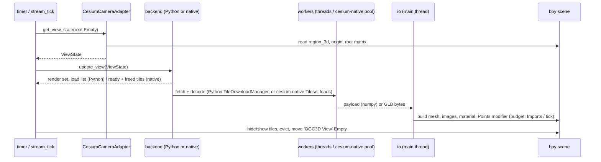

Stream OGC 3D Tiles tilesets directly into Blender with Cesium-compatible
Level-of-Detail and non-blocking HTTP downloads. Two interchangeable
backends: pure Python (always available) or cesium-native via
[cesium-native-python](https://github.com/calebbuffa/cesium-native-python).

```
blender_ogc3dtiles/
├── __init__.py              # register / unregister (metadata in blender_manifest.toml)
├── addon_prefs.py           # backend choice, wheel installer, cache, libraries, dev options
├── tileset/
│   ├── traversal.py         # Tile tree, transforms, SSE, culling, select()      (no bpy)
│   ├── backend.py           # PythonBackend + factory / probe
│   ├── native_backend.py    # cesium-native backend, tile preparer, overlays    (no bpy)
│   ├── native_mesh.py       # cesium-native Model → numpy payload               (no bpy)
│   ├── gltf_payload.py      # GLB → numpy payload for the Python backend        (no bpy)
│   ├── asset_fixes.py       # accessor fixes: data: URIs, subtree JSON, empty tiles, NAS files
│   ├── feature_meta.py      # metadata columns and class codes                  (no bpy)
│   ├── voxels.py, origin.py, budget.py
│   └── props.py             # bpy.types.Scene.ogc3dtiles PropertyGroup
├── camera/__init__.py       # viewport or camera → ViewState (ECEF, p00/p11, frustum, ortho)
├── io/__init__.py           # Python-backend downloads, disk cache, tile objects from payloads
├── ui/                      # sidebar panels + modal operator (stream_tick)
├── materials.py, compositor.py, clipping.py, overlays.py, ...  # shared node groups, features
└── paths.py, library.py, cachectl.py                            # URLs, libraries, cache size
```

## Pipeline at a glance

Both backends share the same contract: every streaming tick, the add-on
reads the viewport from `bpy`, hands a `ViewState` to a *backend* that
decides which tiles to draw and which to load, and turns the content that
arrives into Blender objects.  Only the middle differs.

```mermaid
flowchart LR
    classDef bpy fill:#e8f1ff,stroke:#4a78c2,color:#111
    classDef addon fill:#fff6e0,stroke:#c99a2e,color:#111
    classDef native fill:#eaf7ea,stroke:#4f9d55,color:#111
    classDef net fill:#f4e8ff,stroke:#8a5ac2,color:#111

    subgraph BPY["Blender (bpy)"]
        direction TB
        VP["3D viewport<br/>region_3d.view_matrix<br/>window_matrix, region.height"]:::bpy
        PROPS["scene.ogc3dtiles<br/>list, Max SSE, origin,<br/>point / material / compositor props"]:::bpy
        OBJ["bpy.data: meshes, images,<br/>materials, node groups,<br/>'3D Tiles' collections + root Empties"]:::bpy
        TIMER["modal operator timer (GUI)<br/>or stream_tick() (-b)"]:::bpy
    end

    subgraph CAM["camera/"]
        ADAPT["CesiumCameraAdapter.get_view_state(root)<br/>ENU ↔ ECEF via scene origin + root Empty<br/>frustum planes, fov, height px"]:::addon
        EYE["viewport_eye()<br/>eye, p11, height, persp"]:::addon
    end

    subgraph UI["ui/ (per stream)"]
        TICK["stream_tick → _sync_streams<br/>_tick_python / _tick_native"]:::addon
        VIS["_apply_visibility / _evict<br/>set_tile_visible, remove_tile"]:::addon
        PROXY["io.update_view_proxy / _eye_tick<br/>→ 'OGC3D View' Empty + Value nodes"]:::addon
    end

    subgraph PY["Python backend (tileset/)"]
        TRAV["traversal.select()<br/>SSE, frustum, foveation,<br/>REPLACE/ADD, one sorted queue"]:::addon
        DLM["io.TileDownloadManager<br/>threads, keep-alive Session,<br/>DiskCache, unwrap b3dm/pnts/glb"]:::addon
        GPL["gltf_payload.glb_to_payload<br/>numpy arrays (worker thread)"]:::addon
    end

    subgraph NAT["cesium-native-python backend"]
        CNB["CesiumNativeBackend<br/>Tileset.update_view(ViewState)<br/>options.maximum_screen_space_error live"]:::native
        PREP["_GlbPreparer (IPrepareRendererResources)<br/>prepare_in_load_thread: native_mesh.extract_mesh_payload<br/>prepare_in_main_thread: on_main_thread_ready"]:::native
        CACHE["shared AsyncSystem + CachingAssetAccessor<br/>(sqlite http-cache, one per process)"]:::native
    end

    subgraph BUILD["io/ (main thread)"]
        B1["build_tile_from_payload<br/>foreach_set, packed images,<br/>matte / unlit material, Points modifier"]:::addon
        B2["import_glb_file<br/>(glTF importer fallback)"]:::addon
        MAT["materials.ensure_relight_group<br/>compositor.build_beauty_tree"]:::addon
    end

    NET[("tileset.json / b3dm / pnts / glb<br/>HTTP(S), ion, share links")]:::net

    TIMER --> TICK
    VP --> ADAPT --> TICK
    VP --> EYE --> PROXY --> OBJ
    PROPS --> TICK
    TICK -- "ViewState" --> TRAV
    TICK -- "ViewState (pos, dir, up, fov or ortho extents)" --> CNB
    TRAV -- "load list" --> DLM --> NET
    DLM --> GPL -- "payload" --> B1
    DLM -- "glb file" --> B2
    CNB --> CACHE --> NET
    CNB --> PREP -- "payload or glb bytes" --> B1
    TRAV -- "render set" --> VIS
    CNB -- "tiles to render / freed" --> VIS
    B1 --> OBJ
    B2 --> OBJ
    VIS --> OBJ
    OBJ -. "Relight / compositor checkbox" .-> MAT --> OBJ
```



What each stage needs and produces:

| stage | reads | produces | thread |
|---|---|---|---|
| `camera.CesiumCameraAdapter` | viewport matrices, scene origin (lat/lon/h), root Empty transform | `ViewState` in the tileset's ECEF frame | main |
| `traversal.select` (Python) | `Tile` tree (parsed `tileset.json`, external tilesets grafted on arrival), `ViewState`, Max SSE, foveation | render set, keep set, one priority-sorted load list | main |
| `io.TileDownloadManager` | load list, token, disk cache | `FetchResult`: GLB parts (+ RTC) or external tileset JSON, numpy payloads when *Direct mesh* | worker threads |
| `CesiumNativeBackend.update_view` | `ViewState` as position / direction / up / fov, or orthographic half extents | tiles to render, newly ready / freed tiles, stats | main (cesium-native pool for loads) |
| `_GlbPreparer.prepare_in_load_thread` | `Model` from cesium-native | numpy payload (`native_mesh.extract_mesh_payload`) or stripped GLB bytes | cesium-native workers |
| `io.build_tile_from_payload` / `import_glb_file` | payload or GLB file, tile matrix (`tile_world_matrix`, `apply_payload_offset` in float64) | mesh object under the root Empty, hidden until selected | main |
| `_apply_visibility` / `_evict` | render set, keep set, Max Tiles | `set_tile_visible` (`hide_viewport` / `hide_render`), `remove_tile` | main |
| `materials` / `compositor` | tile objects, panel sliders | shared "OGC3D Relight" group, "OGC3D Beauty" compositor tree | main, on demand |

One tick, in order:



## Streaming loop (both backends)

Every 50 ms the modal operator runs `ui.stream_tick()`:

1. drain worker results (external `tileset.json` are grafted into the tree,
   ready tiles are queued),
2. build at most `Imports / tick` tiles: numpy payloads through
   `io.build_tile_from_payload`, Blender's glTF importer as the fallback
   (with cesium-native's selection, the main-thread cost; 1 keeps the
   viewport smooth),
3. re-run the selection only when the view changed, something arrived, or
   0.5 s passed,
4. submit loads in priority order (largest screen-space error first) up to
   the download concurrency,
5. evict least-recently-wanted hidden tiles above `Max Tiles`.

Imports never touch the user's selection or active object. Every tile is
parented to one root Empty per tileset inside the `3D Tiles` collection, so
the whole dataset can be moved / rotated / scaled, hidden or folded as one.

## What keeps Blender busy while streaming

Everything that touches `bpy` runs on Blender's main thread, between
redraws: building tile meshes and materials, attaching overlay rasters,
deleting evicted tiles, and cesium-native's tile selection (about 20 ms per
update for Google Photorealistic 3D Tiles).  Downloads and glTF decoding
run in worker threads.  Measured on Google tiles over Rome, about 550 tiles
on screen, Blender 5.3, orbiting view:

| | redraw interval |
|---|---|
| streaming, default budget | 87 ms |
| streaming, view moving (navigation budget 8 ms) | 36 ms |
| stopped, Solid | 10 ms |
| stopped, Material Preview | 23 ms |
| stopped, Rendered (EEVEE) | 147 ms |

The knobs: *Imports / tick* is the build budget when the view rests
(12 ms per import); *Build ms while navigating* (LOD / Streaming > Viewport Performance)
is the budget while the view moves and 0.3 s after, so orbiting stays fluid
and loading catches up when you stop; Solid shading draws fastest; with
raster overlays, *Raster detail* trades imagery resolution for fewer
downloads (cesium-native shows a tile only once all its rasters are in).
Tiles are deleted in one `bpy.data.batch_remove` per tick (deleting them one
by one is quadratic in the number of objects), so a restart or *Clear All
Tiles* takes well under a second.

### Measuring it

Blender has no profiler for add-ons; the numbers of this page come from plain Python, in a script run
with `blender --python`:

- every function of the streaming loop is replaced by a wrapper that adds up `time.perf_counter()`
  around it (`ui.stream_tick`, `_build_native_tile`, `build_tile_from_payload`, the backend's
  `update_view`...);
- a draw handler on the 3D viewport (`SpaceView3D.draw_handler_add`) notes each redraw: their count per
  30 s and the gaps between them are what a person at the screen feels;
- `depsgraph_update_pre` / `_post` handlers time Blender's own scene updates;
- for one function line by line, its source is rewritten with a timer around each statement (`ast`),
  keeping wall time and the thread's CPU time: a line whose wall time is far above its CPU time is
  waiting for Python's lock, held by a load thread.

`cProfile` is of little use here: on Python 3.12 and later it also counts the load threads. Windows
draws a window about once a second while the session is locked, so redraw counts are only valid with the
session open. Runs vary with the machine's state, up to three times on the same build: builds are
compared by alternating them, twice.

The same 5 minute walk (Iconem datasets over Google 3D Tiles at St Peter's, a view change every 4 s,
4K screen, RTX A1000 laptop), per 30 s:

| Build | Redraws | One gap in ten above | Streaming step, median | Tiles built | Per tile |
|---|---|---|---|---|---|
| PNG encoding of decoded textures | 52 to 56 | 1.5 s | 153 to 164 ms (one in ten above 1.1 s) | 350 to 420 | 15 to 17 ms |
| Decoded textures as TIFF | 119 to 120 | 0.33 to 0.37 s | 170 ms | 640 to 650 | 21 to 22 ms |
| One build budget for all tilesets | 143 to 151 | 0.28 to 0.29 s | 120 to 132 ms | 554 to 600 | 20 to 22 ms |
| Normals as a plain attribute | 166 | 0.26 s | 100 ms | 714 | 13.5 ms |
| the same, *Lighter tiles* | 164 | 0.25 s | 102 ms | 851 | 10.2 ms |

The last two rows are one clean run each. The streaming step still takes over half of the main thread
while tiles pour in: that is the build budget (*Imports / tick*, 48 ms at rest), which a faster build
fills with more tiles. Lowering *Imports / tick* is what makes the viewport smoother, at the cost of a
slower fill. Over 20 minutes of that walk the viewport slows from about 150 to 100 redraws per 30 s, with
Blender at 6.9 GB of memory and 3.3 of the laptop's 4 GB of video memory; the cause is not found yet.

### Giving a mesh to Blender from Python

Three ways, from slowest to fastest, to hand the arrays of a tile to a `bpy` mesh:

| | How | Cost |
|---|---|---|
| `mesh.from_pydata(verts, edges, faces)` | Python lists, one object per vertex and face | the slowest; not measured here |
| `mesh.vertices.foreach_set("co", array)`, `loops.foreach_set("vertex_index", ...)`, `uv_layer.data.foreach_set("uv", ...)` | a numpy array, copied through the property's setter, element by element | 19.5 ms at 33,000 triangles |
| `mesh.attributes["position"].data.foreach_set("vector", array)`, `".corner_vert"`, the UV map by its name | the same array, copied into the attribute's own buffer | 9 ms at 33,000 triangles |

The add-on uses the third, with the second as a fallback. Vertex normals follow the same idea: a
`custom_normal` vector attribute on the vertices (Blender 4.5 and later) instead of
`normals_split_custom_set_from_vertices`, 0 ms against 17 ms at 12,000 triangles. The face smoothing is
`mesh.shade_smooth()`, and a material index is written only when a tile has more than one material.
What remains per tile on the walk above, 9 ms inside `build_tile_from_payload`: the material hooks
2.2 ms, the material 1.3 ms, `validate` 0.9 ms, the face corners 0.8 ms, the image 0.8 ms.

## Pure Python backend (`tileset/traversal.py`)

- Tile `transform` matrices compose down the tree; `box`/`sphere` volumes
  are transformed, `region` is geodetic.
- Screen-space error `sse = ge · viewport_h · p11 / (2 · dist)` with `p11`
  read from the viewport projection matrix (exact FOV, orthographic aware).
- Frustum culling with the viewport's own planes (rotated into ECEF) plus a
  maximum distance (`Max Distance`).
- Dynamic SSE: `thr(d) = SSE · (1 + d / Detail Falloff)`, so detail
  concentrates near the camera and distant regions settle at coarse LODs.
- `REPLACE` keeps the parent visible until every visible child subtree is
  imported (no holes); `ADD` renders parent and children together.
- Workers unwrap `b3dm` / `cmpt` / `glb`, trim the 8-byte container padding
  some exporters (RealityCapture) add, extract `RTC_CENTER` / `CESIUM_RTC`,
  and write GLBs into `%LOCALAPPDATA%/blender_ogc3dtiles/cache`; a second
  session of the same tileset downloads nothing.
- Placement: tile Empty = `ENU_from_ECEF · T_tile · Translate(RTC)`. Payloads
  arrive Z-up already; on the importer fallback, Blender's importer converts
  glTF Y-up to Z-up.

## Direct mesh construction (cesium-native, default)

`tileset/native_mesh.py` turns the decoded cesium-native `Model` into numpy
arrays on the worker thread (positions with node transforms applied and
converted to Z-up, triangle indices, per-loop UVs, normals, COLOR_0, the
original JPEG/PNG bytes of the textures or PNG re-encoded from decoded
pixels for KTX2).  `io.build_tile_from_payload` then creates the mesh with
`foreach_set`, packs the textures from bytes and builds a matte Principled
material.  Point clouds become vertex-only meshes, see [Point clouds](/features/point-clouds).
Measured main-thread cost per tile: 8–9 ms direct vs 10–13 ms
through `bpy.ops.import_scene.gltf`; the direct path also needs no temp files
and works regardless of which glTF extensions Blender's importer knows.
Toggle: "Direct mesh" in the add-on preferences, folded Developer section (off = GLB re-import).

The Python backend uses the same route: `tileset/gltf_payload.py` is a pure
numpy GLB reader (any accessor type incl. KHR_mesh_quantization, interleaved
views, strips/fans/points, embedded JPEG/PNG) that runs on the download
workers (~2 ms per tile) and feeds `build_tile_from_payload`; Draco, meshopt,
KTX2 or external buffers fall back to Blender's importer.  Both producers
recentre the vertices on their float64 centroid and move the offset into the
object matrix, so content with projected-CRS or ECEF magnitudes in its node
transforms never gets quantised to float32 (0.1 m steps, view-dependent
wobble).  HTTP uses one keep-alive `requests.Session` per worker thread (TLS
handshake once per thread, not once per tile).

## cesium-native backend (`tileset/native_backend.py`)

Needs the `cesium` module (a cesium-native-python wheel for Python 3.11 to
3.13, the same minor version as Blender's interpreter). It constructs
`Tileset(TilesetExternals(CachingAssetAccessor(CurlAssetAccessor), preparer, AsyncSystem), url)`
and drives it with `update_view_group`. cesium-native does the traversal,
implicit tiling, `b3dm/i3dm/pnts/cmpt` conversion, Draco / meshopt / KTX2
decoding, the LRU tile cache (`maximum_cached_bytes`) and the sqlite HTTP
cache. Our `IPrepareRendererResources` subclass extracts numpy arrays from
each decoded `Model` in `prepare_in_load_thread`, on cesium-native's worker
threads with the GIL held (`native_mesh.extract_mesh_payload`, about 2 ms per
tile on a photogrammetry mesh); the main thread builds the Blender mesh from
them. With *Direct mesh* off, or when extraction fails, it serialises the
`Model` back to a GLB instead (`GltfUtilities.collapse_to_single_buffer` +
`GltfWriter.write_glb`, KTX2 textures re-encoded to PNG) for Blender's
importer. Placement: Empty = `ENU_from_ECEF · T_tile · Zup→Yup`.
`tileset/asset_fixes.py` wraps the asset accessor: it answers `data:` URIs,
completes subtree JSON, and raises the geometric error of content-less tiles
to their parent's so cesium-native refines through them (see Gaussian splat
tiles).

## Coordinate system

```
WGS84 (lat/lon/height)
        │  _geodetic_to_ecef()
        ▼
    ECEF (metres, geocentric)
        │  ecef_to_enu(origin_lat, origin_lon, origin_height)
        ▼
    ENU  (East / North / Up, origin-relative metres)
        │  direct mapping
        ▼
    Blender XYZ  (X=East, Y=North, Z=Up)
```
