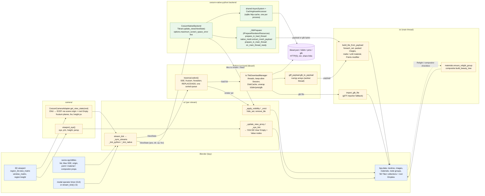
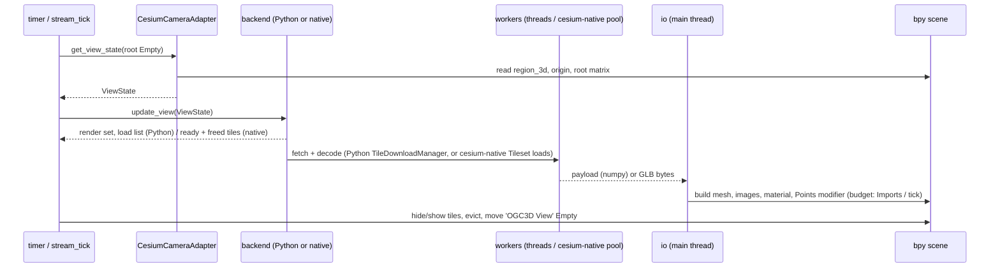

Stream OGC 3D Tiles tilesets directly into Blender with Cesium-compatible
Level-of-Detail and non-blocking HTTP downloads. Two interchangeable
backends: pure Python (always available) or cesium-native via
[cesium-native-python](https://github.com/calebbuffa/cesium-native-python).

```
blender_ogc3dtiles/
├── __init__.py              # bl_info, register/unregister
├── addon_prefs.py           # backend choice (AUTO / CESIUM / PYTHON), dev options
├── tileset/
│   ├── traversal.py         # Tile tree, transforms, SSE, culling, select()  (no bpy)
│   ├── backend.py           # PythonBackend + factory / probe
│   ├── native_backend.py    # cesium-native backend (real binding API)      (no bpy)
│   └── props.py             # bpy.types.Scene.ogc3dtiles PropertyGroup
├── camera/__init__.py       # viewport → ViewState (ECEF pos/dir/up, p00/p11, frustum)
├── io/__init__.py           # thread pool fetch + unwrap + disk cache, GLB import
└── ui/__init__.py           # sidebar panel + modal operator (stream_tick)
```

## Pipeline at a glance

Both backends share the same contract: every streaming tick, the add-on
reads the viewport from `bpy`, hands a `ViewState` to a *backend* that
decides which tiles to draw and which to load, and turns the content that
arrives into Blender objects.  Only the middle differs.



What each stage needs and produces:

| stage | reads | produces | thread |
|---|---|---|---|
| `camera.CesiumCameraAdapter` | viewport matrices, scene origin (lat/lon/h), root Empty transform | `ViewState` in the tileset's ECEF frame | main |
| `traversal.select` (Python) | `Tile` tree (parsed `tileset.json`, external tilesets grafted on arrival), `ViewState`, Max SSE, foveation | render set, keep set, one priority-sorted load list | main |
| `io.TileDownloadManager` | load list, token, disk cache | `FetchResult`: GLB parts (+ RTC) or external tileset JSON, numpy payloads when *Direct mesh* | worker threads |
| `CesiumNativeBackend.update_view` | `ViewState` as position / direction / up / fov | tiles to render, newly ready / freed tiles, stats | main (cesium-native pool for loads) |
| `_GlbPreparer.prepare_in_load_thread` | `Model` from cesium-native | numpy payload (`native_mesh.extract_mesh_payload`) or stripped GLB bytes | cesium-native workers |
| `io.build_tile_from_payload` / `import_glb_file` | payload or GLB file, tile matrix (`tile_world_matrix`, `apply_payload_offset` in float64) | mesh object under the root Empty, hidden until selected | main |
| `_apply_visibility` / `_evict` | render set, keep set, Max Tiles | `hide_set`, `remove_tile` | main |
| `materials` / `compositor` | tile objects, panel sliders | shared "OGC3D Relight" group, "OGC3D Beauty" compositor tree | main, on demand |

One tick, in order:



## Streaming loop (both backends)

Every 50 ms the modal operator runs `ui.stream_tick()`:

1. drain worker results (external `tileset.json` are grafted into the tree,
   ready GLBs are queued),
2. import at most `Imports / tick` GLBs with `bpy.ops.import_scene.gltf`
   (the only main-thread cost; 1 keeps the viewport smooth),
3. re-run the selection only when the view changed, something arrived, or
   0.5 s passed,
4. submit loads in priority order (largest screen-space error first) up to
   the download concurrency,
5. evict least-recently-wanted hidden tiles above `Max Tiles`.

Imports never touch the user's selection or active object. Every tile is
parented to one root Empty per tileset inside the `3D Tiles` collection, so
the whole dataset can be moved / rotated / scaled, hidden or folded as one.

## What keeps Blender busy while streaming

Everything that touches `bpy` runs on Blender's main thread, between
redraws: building tile meshes and materials, attaching overlay rasters,
deleting evicted tiles, and cesium-native's tile selection (about 20 ms per
update for Google Photorealistic 3D Tiles).  Downloads and glTF decoding
run in worker threads.  Measured on Google tiles over Rome, about 550 tiles
on screen, Blender 5.3, orbiting view:

| | redraw interval |
|---|---|
| streaming, default budget | 87 ms |
| streaming, view moving (navigation budget 8 ms) | 36 ms |
| stopped, Solid | 10 ms |
| stopped, Material Preview | 23 ms |
| stopped, Rendered (EEVEE) | 147 ms |

The knobs: *Imports / tick* is the build budget when the view rests
(12 ms per import); *Build ms while navigating* (LOD / Streaming > Advanced)
is the budget while the view moves and 0.3 s after, so orbiting stays fluid
and loading catches up when you stop; Solid shading draws fastest; with
raster overlays, *Raster detail* trades imagery resolution for fewer
downloads (cesium-native shows a tile only once all its rasters are in).
Tiles are deleted in one `bpy.data.batch_remove` per tick (deleting them one
by one is quadratic in the number of objects), so a restart or *Clear All
Tiles* takes well under a second.

## Pure Python backend (`tileset/traversal.py`)

- Tile `transform` matrices compose down the tree; `box`/`sphere` volumes
  are transformed, `region` is geodetic.
- Screen-space error `sse = ge · viewport_h · p11 / (2 · dist)` with `p11`
  read from the viewport projection matrix (exact FOV, orthographic aware).
- Frustum culling with the viewport's own planes (rotated into ECEF) plus a
  maximum distance (`Max Distance`).
- Dynamic SSE: `thr(d) = SSE · (1 + d / Detail Falloff)`, so detail
  concentrates near the camera and distant regions settle at coarse LODs.
- `REPLACE` keeps the parent visible until every visible child subtree is
  imported (no holes); `ADD` renders parent and children together.
- Workers unwrap `b3dm` / `cmpt` / `glb`, trim the 8-byte container padding
  some exporters (RealityCapture) add, extract `RTC_CENTER` / `CESIUM_RTC`,
  and write GLBs into `%LOCALAPPDATA%/blender_ogc3dtiles/cache`; a second
  session of the same tileset downloads nothing.
- Placement: tile Empty = `ENU_from_ECEF · T_tile · Translate(RTC)`; Blender's
  importer already converts glTF Y-up to Z-up.

## Direct mesh construction (cesium-native, default)

`tileset/native_mesh.py` turns the decoded cesium-native `Model` into numpy
arrays on the worker thread (positions with node transforms applied and
converted to Z-up, triangle indices, per-loop UVs, normals, COLOR_0, the
original JPEG/PNG bytes of the textures or PNG re-encoded from decoded
pixels for KTX2).  `io.build_tile_from_payload` then creates the mesh with
`foreach_set`, packs the textures from bytes and builds a matte Principled
material.  Point clouds become vertex-only meshes, see [Point clouds](#point-clouds).
Measured main-thread cost per tile: 8–9 ms direct vs 10–13 ms
through `bpy.ops.import_scene.gltf`; the direct path also needs no temp files
and works regardless of which glTF extensions Blender's importer knows.
Toggle: "Direct mesh" in the add-on preferences, Developer box (off = GLB re-import).

The Python backend uses the same route: `tileset/gltf_payload.py` is a pure
numpy GLB reader (any accessor type incl. KHR_mesh_quantization, interleaved
views, strips/fans/points, embedded JPEG/PNG) that runs on the download
workers (~2 ms per tile) and feeds `build_tile_from_payload`; Draco, meshopt,
KTX2 or external buffers fall back to Blender's importer.  Both producers
recentre the vertices on their float64 centroid and move the offset into the
object matrix, so content with projected-CRS or ECEF magnitudes in its node
transforms never gets quantised to float32 (0.1 m steps, view-dependent
wobble).  HTTP uses one keep-alive `requests.Session` per worker thread (TLS
handshake once per thread, not once per tile).

## cesium-native backend (`tileset/native_backend.py`)

Needs the `cesium` module (built from cesium-native-python, Python ≥ 3.12,
same minor version as Blender's interpreter). It constructs
`Tileset(TilesetExternals(CachingAssetAccessor(CurlAssetAccessor), preparer, AsyncSystem), url)`
and drives it with `update_view_group`. cesium-native does the traversal,
implicit tiling, `b3dm/i3dm/pnts/cmpt` conversion, Draco / meshopt / KTX2
decoding, the LRU tile cache (`maximum_cached_bytes`) and the sqlite HTTP
cache. Our `IPrepareRendererResources` subclass serialises each decoded
`Model` back to a GLB (`GltfUtilities.collapse_to_single_buffer` +
`GltfWriter.write_glb`, KTX2 textures re-encoded to PNG) which the same
import step consumes. Placement: Empty = `ENU_from_ECEF · T_tile · Zup→Yup`.
`tileset/asset_fixes.py` wraps the asset accessor: it answers `data:` URIs,
completes subtree JSON, and raises the geometric error of content-less tiles
to their parent's so cesium-native refines through them (see Gaussian splat
tiles).

## Coordinate system

```
WGS84 (lat/lon/height)
        │  _geodetic_to_ecef()
        ▼
    ECEF (metres, geocentric)
        │  ecef_to_enu(origin_lat, origin_lon, origin_height)
        ▼
    ENU  (East / North / Up, origin-relative metres)
        │  direct mapping
        ▼
    Blender XYZ  (X=East, Y=North, Z=Up)
```
